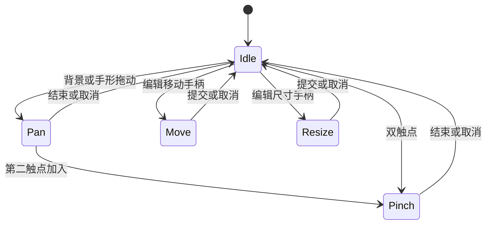

# Nav 无限画布 V1 完整实施方案

日期：2026-10-18  
状态：待实施设计；本文件不表示代码已修改、测试已通过或已上线。  
代码基线：`wymix-tech/Nav`，main 提交 `27e915f1f33692fa8c90b8736974255d0b73eff9`。实施前应重新核对 main，并保留新增功能。  
建议统一开发分支：`feat/infinite-canvas-v1`。

## 1. V1 目标与范围

V1 交付一个具有稳定世界坐标、独立相机和可靠保存边界的空间工作台。用户能在任何方向浏览、在眼前添加组件、调整组件位置和尺寸，并在窗口变化、刷新、断网、重新登录后保留正确的数据。

核心约定：

1. 组件位置和尺寸属于文档；窗口大小改变不修改它们。
2. 相机属于当前浏览环境；平移、缩放、回到默认和适应全部不修改文档、不触发文档同步、不占用内容撤销历史。
3. 只有“发布为默认视角”将当前相机明确保存为共享文档的一部分。
4. 新组件出现在当前可见范围；通过坐标转换决定位置。
5. 小窗口保留空间浏览能力，同时允许用户主动切换列表视图。
6. 升级保留现有网格、画布、组件配置和离线草稿。

### 1.1 本期交付

| 领域 | V1 内容 |
| --- | --- |
| 坐标 | 世界坐标、视口局部坐标、浏览器 client 坐标的统一转换 |
| 相机 | 平移、光标锚定缩放、100%、适应全部、回默认、发布默认 |
| 交互 | 背景拖动、空格拖动、中键拖动、手形工具、触控板、触屏基本操作 |
| 编辑 | 保留单组件移动、调整尺寸、固定网格吸附、键盘调整和单次撤销 |
| 插入 | 可见区域中心添加、组件库拖入指定位置；触屏可使用点击添加 |
| 视图 | 响应实际容器尺寸、小地图、主动切换空间／列表视图 |
| 存储 | 本地相机独立保存，文档继续使用现有本地优先快照同步 |
| 兼容 | 文档升级、原始数据备份、旧客户端写入保护、旧离线队列隔离 |

### 1.2 后续版本范围

V2：框选、多选、分组、区域框、层级锁定、智能对齐、搜索定位、多个命名视角。  
V3：视口裁剪、分级显示、空间索引、组件运行状态外置、增量同步、空间分块加载。

V1 不增加多人协作、CRDT、通用连线编辑器或新画布渲染引擎；维持当前 100 个组件的产品限制。坐标和生命周期接口为后续扩展留出边界，但不提前实现完整系统。

## 2. 当前实现与变更依据

以下是基于上述提交的静态代码检查，不是本次运行测试的结论。

| 当前位置 | 已有实现／限制 | V1 处理 |
| --- | --- | --- |
| `CanvasGrid.vue` | `scale = zoom × ratio`，ratio 依赖旧参考宽高 | 改为世界单位直接乘相机 zoom；旧比例仅用于迁移 |
| `CanvasGrid.vue` | `width < 768` 自动堆叠 | 改成本地 presentation 设置，窗口变化不改变视图类型 |
| `CanvasGrid.vue` | 相机、坐标、手势、小地图、编辑混在一个组件 | 拆分纯计算、相机 store、交互控制器和视图 |
| `dashboardStore.ts` | `updateViewport()` 使用 `mutate/commit` | 普通浏览走独立相机存储；发布默认才提交文档 |
| `WidgetLibrary.vue` | 画布添加依赖网格放置，通常追加到最底部 | 按当前视口／拖入点创建画布坐标 |
| `App.vue` | main 的最小高度、padding 与画布自身高度叠加 | 空间视图采用独立的满可用高度容器 |
| `validation.ts` | 画布组件仍要求合法网格布局 | V1 保留兼容字段，但解除画布新增对网格空间查找的依赖 |
| `localDatabase.ts` | 只有 dashboards、installedWidgets、backups、sync | 增加独立 viewPreferences 表 |
| `syncAdapter.ts` | 不可变操作 ID、版本条件、草稿代际、租约 | 保留；相机不进入该队列；升级不改写旧操作内容 |
| 服务端 `db/state.ts` | state_json 与旧兼容列双写 | 以新文档为权威，保留旧字段作为可重建镜像 |

## 3. 数据模型与状态归属

### 3.1 新模型

```ts
export interface CanvasCamera {
  // 世界坐标中的视口中心
  centerX: number
  centerY: number
  // 每个世界单位占多少 CSS px；1 表示 100%
  zoom: number
}

export interface CanvasSettings {
  version: 1
  defaultCamera: CanvasCamera
}

export interface Dashboard {
  // 其余现有字段继续保留
  documentVersion?: 2
  canvasSettings?: CanvasSettings
}

export interface CanvasViewPreference {
  key: string
  version: 1
  camera: CanvasCamera
  presentation: 'spatial' | 'list'
  updatedAt: string
}
```

升级后的写入要求 `documentVersion: 2`；读取入口允许识别旧数据并交给显式迁移流程。`layoutVersion: 2` 继续表示现有网格布局协议，不改变其含义。新文档版本和网格版本分开。

`WidgetInstance.canvas` 的 x、y、w、h 保留为世界坐标。`originalW/originalH` 原样保留，不用于自动重写当前尺寸。

V1 使用现有 widgets 数组和 grid/canvas 布局模式，不全面替换成节点树。已有 widgets.layouts 字段继续保留，以支持切回网格。新画布组件只需生成合法兼容布局，不能再因网格找不到位置而阻止画布插入。

### 3.2 状态归属表

| 状态 | 是否进入共享文档 | 是否同步 | 是否进入文档撤销 |
| --- | --- | --- | --- |
| 组件增删、配置、画布位置与尺寸 | 是 | 是 | 是 |
| 标题、背景、grid/canvas 模式 | 是 | 是 | 是 |
| 发布的 defaultCamera | 是 | 是 | 是 |
| 当前 camera | 否 | 否 | 否 |
| 空间／列表 presentation | 否 | 否 | 否 |
| pointer 草稿、按键状态、当前工具 | 否 | 否 | 否 |
| 草稿输入、聊天流、监控连接 | 保持现有组件机制 | 保持现有机制 | 不因相机变化产生历史 |

V1 不实施组件运行状态的全面外置。通过保持组件实例和 DOM 挂载稳定，保证平移、缩放、窗口变化、空间／列表切换不重建聊天和插件实例。将来的裁剪必须在 V3 补齐运行状态保护后启用。

## 4. 坐标体系与相机数学

### 4.1 坐标约定

- 世界坐标：组件数据中的 x/y/w/h，允许负坐标。
- 视口坐标：画布根元素内容区域左上角为原点，单位 CSS px。
- client 坐标：PointerEvent.clientX/clientY，以浏览器视口为基准。
- 所有容器测量使用 CSS px；不将 devicePixelRatio 乘进 DOM 坐标。
- 根容器不使用边框和内部 padding；UI 浮层使用独立层，避免坐标原点歧义。

设世界点为 P，相机中心为 C，视口尺寸为 W/H，缩放为 z：

```text
screen.x = (world.x - centerX) * zoom + width / 2
screen.y = (world.y - centerY) * zoom + height / 2

world.x = (screen.x - width / 2) / zoom + centerX
world.y = (screen.y - height / 2) / zoom + centerY

screen.x = client.x - viewportRect.left
screen.y = client.y - viewportRect.top
```

DOM 世界层变换：`translate(W/2 - centerX*z, H/2 - centerY*z) scale(z)`；transform-origin 固定为 0 0。组件内部尺寸仍按世界单位设置。

这些公式仅在统一工具中实现，其他模块调用，不各自复制。容器和祖先若引入旋转／额外 CSS 缩放，则需统一扩展矩阵求逆；V1 不支持对画布壳应用这种变换。

### 4.2 平移与缩放

平移屏幕增量 dx/dy：`centerX -= dx / zoom`、`centerY -= dy / zoom`。

光标锚定缩放：先用旧相机得到光标对应的世界点 P，再求新相机：

```text
next.centerX = P.x - (anchor.x - width / 2) / next.zoom
next.centerY = P.y - (anchor.y - height / 2) / next.zoom
```

按钮缩放以有效可见区域中心为锚点。滚轮使用指数缩放 `nextZoom = oldZoom * exp(-normalizedDelta * sensitivity)`，先归一化 deltaMode 的像素／行／页差异，最后统一限制倍率。灵敏度为一个集中配置值，通过真实鼠标与触控板验证后确定。

缩放到数值边界时，先限制 zoom 再计算相机，避免锚点跳动；相机位置也触及边界时，以合法范围为优先，允许锚点约束失效。

### 4.3 本期范围

| 项目 | V1 建议值 | 说明 |
| --- | --- | --- |
| zoom | 0.01～8，即 1%～800% | 从当前 10%～300% 扩展；所有入口共用 |
| 组件 x/y | -1,000,000～1,000,000 | 沿用当前数据范围 |
| 组件 w/h | 不超过 16,384 | 下限应用组件／插件 minSize |
| 相机中心 x/y | -2,000,000～2,000,000 | 留出边缘浏览空间，和组件范围分开 |
| 网格吸附 | 20 世界单位 | 保留现有行为；不随 zoom 改变 |

所有值必须有限；拒绝 NaN、Infinity、字符串伪装数字和非法尺寸。常量只定义一次，前后端验证和交互计算共同引用。浏览器缩放 100% 与应用画布 100% 是不同概念；界面百分比只表示应用 zoom。

### 4.4 窗口变化规则

窗口、状态栏、侧栏改变可用尺寸时：保持 C 和 z，不改任何组件数据。使用 ResizeObserver 观察实际根容器；尺寸为零或未完成测量时不执行 fit、初始化相机或插入。

交互中尺寸变化，取消本次未提交的 move/resize/pan，恢复起始状态，再应用新尺寸；不以旧尺寸计算 pointerup。组件库的临时收起应保持停靠区占位，避免交互自身触发容器变化。

## 5. 相机初始化、保存与恢复

### 5.1 初始化优先级

在文档载入、根容器有效尺寸就绪后执行一次：

1. 当前会话已存在的有效相机。
2. 当前数据空间的本机有效视角记录。
3. 该设备首次升级时，由升级前原始相机和当前容器换算的兼容相机。此种子只在原始文档版本小于 2 且本机未完成该文档的相机迁移时使用；升级完成后的兼容镜像不能再次当成旧浏览视角。
4. 新文档中的 defaultCamera。
5. 没有可用默认时，非空画布适应全部，空画布使用中心 0/0、zoom 1。

明确点击“回到默认”使用最新共享 defaultCamera；远端默认改变不打断正在浏览的用户。文档远端刷新也不覆盖当前相机。

### 5.2 本地存储

- Dexie 升级新增 `viewPreferences: 'key'`，保留其余表。
- key 按存储模式、服务实例身份、dashboardId 隔离；origin 本身由 IndexedDB 隔离。
- standalone 使用本地生成并持久保存的稳定空间 ID；服务器实例改变时使用新 key，旧记录保留。
- 各标签页独立使用内存相机；不通过文档 BroadcastChannel 广播相机。最后成功写入的视角用于下次新开页面。
- 平移／缩放停止后 300ms 合并写入，按序写入，不每帧落盘。
- 切换文档、visibilitychange 进入 hidden、pagehide 时尽力提前刷新待写入；不承诺突然杀进程前最后一帧一定保存。
- 相机保存失败时保持当前视角可操作，提示“视角未保存”；不设置文档 unsaved，不阻止已保存文档同步。
- 保存恢复带递增序号，忽略迟到的旧读取结果；初始化完成前不允许旧读取覆盖已发生的用户操作。

本机视角记录不进入公开 API、文档导出、文档历史或远端 pendingChanges。导出文档包含共享 defaultCamera。

## 6. 操作规范与事件优先级

### 6.1 桌面操作

| 操作 | 浏览模式 | 编辑模式 |
| --- | --- | --- |
| 左键拖空白 | 平移 | 平移 |
| 中键拖动画布区域 | 平移 | 平移 |
| 空格＋左键拖动 | 平移 | 平移，优先于组件移动 |
| 手形工具拖动 | 平移 | 平移 |
| 普通滚轮／触控板两指滚动 | 画布背景上平移 | 同左 |
| Ctrl/Meta＋滚轮 | 光标锚定缩放 | 同左 |
| 工具栏加减 | 以可见区域中心缩放 | 同左 |
| 组件内部正常点击／滚动 | 交给组件 | 交给组件 |
| 拖组件移动手柄 | 无编辑行为 | 移动 |
| 拖右下角调整手柄 | 无编辑行为 | 调整尺寸 |
| 方向键聚焦移动手柄 | 无编辑行为 | 保留 20 单位移动，Shift 调整尺寸 |
| Escape | 取消当前画布手势 | 同左，撤回本次预览 |

普通滚轮在聊天、列表等组件内部仍由组件消费，即使内部滚动已到边缘，也不隐式转为移动画布。空格在 input、textarea、contenteditable、对话框或组件编辑区域内保持输入语义。仅画布拥有焦点且没有子控件消费时接管快捷键。

只在确实接管事件时 preventDefault；缩放监听需明确允许 preventDefault。列表视图下不接管普通页面滚动。画布缩放不永久关闭浏览器缩放，焦点离开画布后保留浏览器行为。

### 6.2 iframe 特殊规则

跨源／沙箱 iframe 内部的 pointer、wheel、keyboard 事件不会自动冒泡到宿主画布。V1 必须明确处理：

- 普通模式下 iframe 保持可交互，不承诺从 iframe 内直接发起画布手势。
- 用户先点击宿主“手形工具”，在 iframe 上方启用透明手势层，允许连续平移。
- 从宿主画布已发起的平移使用 pointer capture，跨过 iframe 后继续接收事件。
- 当焦点已进入 iframe 时，不依赖父页面收到空格／Escape；提供宿主工具栏的可见退出按钮。
- 组件尺寸和位置操作使用 iframe 外部的宿主手柄。

### 6.3 触屏操作

空间视图下，空白单指拖动平移；宿主可控制区域的双指手势按中点平移和指距比缩放。第二指加入时，从当前相机重新建立双指基线，避免跳动。组件内容区域保留自己的交互；需要跨组件移动时先启用手形工具。iframe 区域遵循同样的手形覆盖规则。

touch-action 只作用于需要接管的区域和手柄；列表视图允许正常页面滚动。浏览器原生页面缩放与应用手势的差异需在 Safari 和 Chromium 中实测。

### 6.4 交互状态机



任意时刻只有一个控制器拥有手势。`pointercancel`、非预期 `lostpointercapture`、blur、权限失效、组件被删除、视图／文档切换、根容器改变均有清理路径。正常 pointerup 主动释放 capture 时，避免再次执行取消逻辑。

Pan/Pinch 成功结束只保存本机视角；取消恢复起始相机。Move/Resize 的预览只在内存中更新，pointerup 后提交一次文档操作；取消则没有文档提交。滚轮缩放按连续事件合并为一个本地保存周期，Escape 结束当前滚轮周期并恢复周期起点。

## 7. 新组件创建与布局模式兼容

### 7.1 点击添加

1. 组件库只发出 `request-add-widget`，不再直接计算布局或提交 store。
2. 画布根据停靠栏／底部抽屉后的有效可见区域取中心 S。
3. 使用 `screenToWorld(S)` 求世界中心 P。
4. 默认世界尺寸从统一解析器取得：内置组件使用现有 constraints 的 w/h 和像素下限；固定设计列单位 120、行单位 90、间距 10，与当前 CanvasGrid 的后备公式一致，即宽 `w*120-10`、高 `h*90-10`。插件 manifest.size 与 minSize 均按这组固定单位换算后取下限；不能把插件网格单位误当像素。既有 canvas 尺寸原样保留，不能按新默认值重算。
5. 左上角为 `P - size/2`；应用 20 单位吸附，并限制合法坐标范围。
6. 现有组件与候选矩形碰撞时，在附近按固定顺序查找，最多尝试 64 次，避免无限查找。
7. 只选择在有效可见区域内、且尺寸允许的候选；没有合适位置时保留中心候选并允许重叠，给出新增高亮。
8. 若组件在当前 zoom 下大于有效视口，按组件范围执行一次本地 fit，确保新增可发现；不自动改变组件世界尺寸。
9. 生成稳定 UUID，校验，执行一次 addWidget 文档提交。

新增高亮在宿主边框层完成；不依赖访问插件内部 DOM。完成后焦点进入宿主组件操作区，不抢占输入框。

### 7.2 拖入添加

组件库采用 Pointer Events 拖入流程，宿主跟踪预览；不把 HTML 原生拖放作为唯一入口。pointerup 在有效画布内时，按 client → viewport → world 转换位置，提交一次新增；在外部释放、Escape 或 pointercancel 则取消。

拖入保持抓取偏移一致；默认可用组件中心跟随指针。拖拽期间组件库停靠占位不变化。触屏可以使用点击添加完成同等功能，V1 不实现拖拽到边缘自动平移。

### 7.3 网格模式保留

- 旧网格组件已有布局原样保留；切换到画布只为缺失 canvas 的组件执行一次迁移。
- 画布新增生成合法的网格兼容布局，不调用网格的全局 findPlacement 决定画布位置。
- 切回网格时，用现有碰撞解算形成可用网格布局；只在必要时更新兼容布局，不改 canvas。
- 网格组件移动不自动覆盖已有 canvas；画布移动不自动覆盖已有网格布局。
- 若现有网格高度限制使兼容布局无法解算，保持画布模式和原数据，说明网格容纳限制；不能删除组件或压缩画布坐标以强行切换。
- 这里的 grid/canvas 是共享布局模式；下面的空间／列表是画布的本地浏览形式，二者不能混为一项设置。

## 8. 工具栏、适应全部、小地图与容器

### 8.1 工具栏

浏览者可用：手形工具、缩小、百分比／100%、放大、适应全部、回到默认、小地图、空间／列表切换。  
有编辑权限者额外可用：发布为默认视角。

发布默认调用 `setDefaultCamera()`，进入一次文档历史；保存失败按文档保存失败处理。撤销发布只恢复共享 defaultCamera，不强制移动当前相机。浏览者加载默认、适应全部和缩放均不需要登录。

空白双击不再隐藏地重置相机，避免将来与创建／选择动作冲突。可见按钮承担返回操作。控件使用 CSS 像素尺寸，不随世界层缩放。

背景点阵随相机平移并按世界网格对齐；极小／极大倍率时按二次幂调整显示间隔，让屏幕点距维持合理密度，不能把点阵固定在屏幕上造成空间错觉。用户壁纸继续保持屏幕背景语义，和世界点阵分层处理。

### 8.2 适应全部

内容边界只使用实际组件范围，不把世界原点强行包含进来。以扣除停靠／遮挡后的有效视口和 32 CSS px 安全边距计算：`zoom = min(availableWidth/boundsWidth, availableHeight/boundsHeight)`，再应用统一倍率边界。

让内容中心对齐有效视口中心；遮挡不对称时通过坐标公式计算 camera，不能直接假定根容器中心。空文档恢复中心 0/0、zoom 1。单组件执行同样算法。

当内容跨度要求小于 1% 时，使用倍率下限并明确提示“已达到最小缩放，可通过小地图定位”；不能声称“全部内容已适应”。零面积、非有限边界和零尺寸容器不得参与除法。

### 8.3 小地图

地图范围是“组件边界 ∪ 当前视口世界范围”，加少量边距，并设置非零最小尺寸。允许远离内容的当前视口始终出现在图中。

地图保持宽高比例，内容矩形和视口矩形使用同一变换。点击换算必须扣除 SVG 留白；建议使用 `getScreenCTM().inverse()` 转换 client 点，不能直接按 clientX/元素宽度线性映射。点击只改变 camera center，保持 zoom，只保存本机视角。

支持键盘打开、关闭与通过按钮返回默认；地图提供可访问名称，不把纯 SVG 点击作为唯一导航途径。V1 不做地图拖动和多层级聚合。

### 8.4 容器与窄屏

- 空间模式 app 壳占满 `100dvh`，使用布局划分状态条和剩余画布区域；各层 min-height:0。
- 画布 main 的 padding 为 0，不继承网格居中宽度和 min-height:100dvh。
- 画布自身 height:100%，不再硬编码扣除假定存在的 64px 顶栏。
- 状态提示变高和侧栏开关仅改变可用视口，不改变世界坐标或相机倍率。
- 右下角画布控件与现有浮动 TopBar 规划独立停靠位置；窄屏避免互相遮挡和横向溢出。
- 不因宽度低于 768 自动切换列表。用户主动选择列表，保存到 viewPreferences。
- 列表顺序按 canvas.y、canvas.x、id 稳定派生；不写回世界坐标，不改变组件高度数据。
- 空间／列表切换保持相同 WidgetHost 实例，只改变布局和尺寸呈现。列表暂不支持几何编辑；配置、移除仍按权限可用。切回空间时恢复原相机。

## 9. 模块边界与接口

建议在现有目录内渐进拆分，避免引入独立大仓库或新的应用框架。

```text
packages/shared/src/canvas/
  types.ts          相机、矩形、尺寸、视角类型
  constants.ts      统一数值边界
  geometry.ts       坐标转换、可见边界、fit、相交、插入候选
  migration.ts      旧模型到 documentVersion 2 的纯转换

packages/frontend/src/canvas/
  useCanvasCamera.ts       相机初始化与浏览操作
  useCanvasInteraction.ts  Pointer、wheel、键盘状态机
  useCanvasInsertion.ts    点击／拖入新增编排
  viewPreferenceService.ts 本地视角读写与合并
  resolveWidgetSize.ts     稳定默认尺寸与插件约束

packages/frontend/src/stores/
  canvasViewStore.ts       当前文档视角与工具状态

packages/frontend/src/components/canvas/
  CanvasStage.vue          根容器和世界层
  CanvasWidgetHost.vue     稳定组件实例、宿主边框和手柄
  CanvasControls.vue       工具栏
  CanvasMinimap.vue        小地图
```

保留 `CanvasGrid.vue` 作为过渡适配入口也可以，但其职责应收敛为组装和事件映射。

接口约定：

| 接口 | 职责 |
| --- | --- |
| `worldToScreen / screenToWorld / clientToViewport` | 纯坐标转换 |
| `panByScreen / zoomAt / fitBounds / resetToDefault` | 只改变相机 |
| `setDefaultCamera(camera)` | 明确的文档命令 |
| `updateCanvas(id, layout)` | 手势完成后的单组件文档命令 |
| `requestAddWidget(type, source, anchor?)` | 当前视口内创建，统一校验与提交 |
| `flushViewPreference()` | 本机视角尽力持久化，不调用文档 adapter |

相机 store 不导入文档 commit/persist；文档 store 不订阅相机的每帧变化。组件库通过应用层桥接请求，不能反向依赖 CanvasStage DOM。接口在整个 V1 中只保留一套实现。

相机每帧只更新世界层 transform 和必要的导航 UI，不能每帧深拷贝 widgets 或给每个 WidgetHost 传入变化的 camera 对象。Move/Resize 在 pointerup 时用最终指针位置计算一次，再取消尚未执行的 requestAnimationFrame，避免末帧丢失。

## 10. 旧数据迁移与协议升级

### 10.1 保留坐标，换算相机

旧屏幕位置公式为：`screen = ratio * (pan + oldZoom * world)`，ratio = min(W/refW, H/refH)，并沿用旧代码的最小值保护。

在当前设备上保留升级前首屏的换算：

```text
newZoom = ratio * oldZoom
newCenterX = (W / (2 * ratio) - oldPanX) / oldZoom
newCenterY = (H / (2 * ratio) - oldPanY) / oldZoom
```

组件 canvas 数值完全不变。新 zoom 超出 1%～800% 时按边界限制，保留中心并提示可适应全部；这些极端旧场景不承诺像素级首屏一致。

共享默认相机使用旧 refW/refH 的参考视口换算，ratio=1，旧 homeX/homeY 作为 pan，zoom=1，保持旧“回到中心”操作的语义。若 home 字段缺失则使用有效旧 pan/zoom。当前浏览视角与共享默认视角分别转换，不能把用户某台设备的瞬时尺寸写成所有人的默认。

没有 canvas 的旧网格组件先使用现有确定性迁移规则生成世界坐标，然后补新相机。迁移不得根据当前设备反复生成组件坐标。

### 10.2 权威字段和兼容镜像

迁移完成后 `canvasSettings.defaultCamera` 为权威；viewport、viewportWidth、viewportHeight 仅保留为兼容镜像与历史参考，不再参与新渲染。

服务端提交时从权威默认相机计算旧 viewport 镜像，不能接受旧字段反向覆盖新相机。镜像按固定 refW/refH 生成 panX/panY，home 使用 zoom=1 时对应的平移；旧协议 zoom 范围与新协议不同，镜像 zoom 可被限制，因此不承诺旧客户端还原新视角。

已经存在的新 canvasSettings 优先于旧 viewport；迁移重复执行必须幂等。未知 documentVersion 不降级、不覆盖，返回需要更新提示。

### 10.3 备份与事务

部署前执行一致性 SQLite 备份，同时备份 uploads。新迁移命令提供 preflight／dry-run／apply：

- preflight：检查旧 schema、非法数值、缺失引用和待修复数据，不自动重排组件。
- apply：每份文档在同一数据库事务中保存 `canvas-camera-v1:<dashboardId>:<sourceRevision>` 原始备份、验证迁移结果、更新 state_json 和兼容列，并将 revision 增加一次。
- 重复执行不重复迁移、不重复增加 revision；异常回滚该文档事务并阻止以半迁移状态开放写入。
- 读取 API 不承担升级写入。旧备份继续保留，管理员 backup 接口增加返回新备份类型。

standalone 在 IndexedDB 同一事务中备份原文档并写入升级文档。本地相机需要容器测量，随后单独写入 viewPreferences；这一步失败不回滚已经正确升级的文档。

### 10.4 旧客户端与离线队列

新写入请求增加 `schemaVersion: 2`，同时校验 snapshot.documentVersion。GET 和 PUT 响应明确返回 `X-Nav-State-Schema: 2`；前端 apiClient 增加获取该元数据的路径。新客户端必须先确认服务端支持版本 2，再发送新版写入，不能假设旧服务端会拒绝未知 JSON 字段。缺少能力标记时暂停远端写入，保留本地草稿并提示更新服务端。

服务端升级后，旧版状态 PUT 返回 426 UPGRADE_REQUIRED，不能仅靠现有 If-Match 防止旧客户端删除新字段。能力标记只表示协议支持，不替代权限、版本条件或文档字段验证。离线状态可以继续本地编辑，重连确认能力后再恢复发送。

旧离线队列的 operationId 与 snapshot 不得原地改变：同一个 ID 可能已经在服务端提交，只是回包丢失。

升级恢复规则：

1. 完整备份旧 SyncRow，包括 pending、snapshot、conflict、revision、generation 和 lease。
2. 发现旧协议 pending 时进入 upgrade-required 状态，停止自动发送；不清空队列。
3. 获取最新远端文档，将旧草稿迁移成独立候选，展示远端／本地差异与恢复选项。
4. 用户选择采用远端时，旧草稿留在备份；选择重新提交本地时，使用最新 revision、最新 instanceId、新 operationId，作为一次明确的新提交。
5. 继续沿用 If-Match；确认后到提交之间远端再次变化仍按 412 冲突处理。
6. 多标签页迁移与恢复使用 IndexedDB 事务和现有 generation 保护；只有选定处理者迁移，其他标签页收到版本变化后重新加载，不能各自复制并发送队列。
7. 对已建立的当前协议队列继续使用现有不可变重试机制，不增加无必要的迁移。

增加 upgrade-required 同步状态及界面文案；不将 426 加入自动指数重试。现有 Service Worker 更新按钮在旧队列存在时先提供备份与恢复入口，不能因为 pendingChanges 一直非零而永久阻止必要更新。若正在生成聊天或进行编辑，先结束／保留当前工作再刷新；不强制无提示刷新。

## 11. 保存、撤销、错误与权限

- 保留现有文档快照、If-Match、幂等 ID、冲突备份、离线持久化和多标签页保护。
- Move/Resize/add/default-camera 每次完成产生一次逻辑文档操作；不能把“一个逻辑操作”误写成“必定只有一个 HTTP 包”，网络失败允许同 ID 重试。
- 新默认相机和全部编辑入口应用相同权限判断。登录只影响共享文档修改；浏览操作持续可用。
- 权限失效立即取消未提交的几何编辑和拖入，退出编辑模式；不把草稿预览写回。已有本地文档草稿按现有同步机制保留。
- 文档保存失败沿用文档错误和备份入口；相机保存失败使用单独轻量状态，不污染文档 unsaved。
- 默认视角被远端更新时仅更新“回到默认”的目标，不跳转当前相机。
- 删除正在交互的组件时，按稳定 ID 取消；指针计算不得依赖必定能 find 到该组件。
- 浏览相机变化不触发组件配置变更，不卸载组件，不重新建立 SSE 或 iframe。
- V1 维持 50 条文档历史和现有总量限制；相机拆分后不额外扩大历史容量。

## 12. 实施拆分与依赖

按一个统一分支、以下顺序提交；所有阶段完成后再合并。阶段中间提交不表示可单独部署。

| 阶段 | 主要改动 | 完成条件 | 依赖 |
| --- | --- | --- | --- |
| P0 基线与样本 | 固定 main、保存回滚点、构建旧画布／旧网格／旧队列样本 | 现有检查基线明确，旧数据样本可复现 | 无 |
| P1 共享模型与纯函数 | camera 类型、常量、几何函数、新文档版本、验证、迁移纯函数 | 数学与迁移测试通过 | P0 |
| P2 升级与独立视角存储 | Dexie 表、相机存储、服务端迁移、旧写入保护、旧队列恢复 | 备份、幂等、426、草稿保留测试通过 | P1 |
| P3 画布视图重构 | 稳定 WidgetHost、独立相机、实际容器尺寸、空间／列表呈现 | 窗口变化无文档写入、组件不重建 | P1、P2 |
| P4 交互与插入 | 状态机、鼠标／触屏／iframe 策略、中心添加和拖入 | 手势取消、单次提交、可见插入通过 | P3 |
| P5 导航与界面 | 工具栏、fit/default、百分比、小地图、窄屏避让 | 导航准确，无遮挡和文档污染 | P3、P4 |
| P6 联调与发布材料 | 生产模式、多浏览器、迁移演练、文档与回滚说明 | 验收矩阵通过并记录限制 | P0～P5 |

主要修改文件：

- shared：types/dashboard.ts、layout.ts、validation.ts、index.ts，以及新增 canvas 模块。
- frontend：App.vue、CanvasGrid.vue、WidgetLibrary.vue、PreferencesPanel.vue、dashboardStore.ts、localDatabase.ts、localAdapter.ts、syncAdapter.ts，以及新增画布模块。
- server：db/state.ts、routes/dashboards.ts、维护 CLI／preflight 与备份接口。
- tests：几何、迁移、存储、服务端协议、浏览器交互测试。
- docs：操作说明、数据迁移、协议版本、部署与回滚。

## 13. 验收矩阵

以下是实施后的目标，不代表本次已经通过。

### 13.1 数学与数据测试

| ID | 场景 | 预期 |
| --- | --- | --- |
| M01 | 正／负坐标，1%、100%、800% 往返转换 | 在约定浮点容差内还原世界点 |
| M02 | 随机相机与锚点缩放 | 不触及位置边界时，锚点世界坐标保持不变 |
| M03 | 鼠标像素、行、页 deltaMode | 均得到有限、方向一致且限幅的结果 |
| M04 | 空文档、单组件、全部在远处、超大跨度 | fit 不除零；不包含无关原点；缩放下限结果明确 |
| M05 | 碰撞密集区新增 | 查找有上限；回退位置可发现；不会卡死 |
| M06 | 非有限坐标、非法尺寸、新旧版本 | 前后端一致拒绝；未知版本不覆盖 |
| M07 | 旧 ratio/pan/zoom 到新 camera | 支持倍率内，参考屏幕点在转换前后相同 |
| M08 | 迁移重复运行与迁移异常 | 坐标不变、revision 只加一次、事务完整回滚 |

### 13.2 存储、协议与恢复测试

| ID | 场景 | 预期 |
| --- | --- | --- |
| S01 | 平移／缩放 100 次后停止 | 文档快照、revision、历史、文档队列完全不变 |
| S02 | 发布默认视角与撤销 | 一次文档操作；撤销不跳转当前相机 |
| S03 | 相机本地保存失败 | 文档仍可保存同步；显示独立错误 |
| S04 | 刷新、多标签页和远端文档更新 | 相机按约定恢复；其他标签页不强制跳转 |
| S05 | 服务实例发生改变 | 使用新视角 key，旧视角保留；原草稿保护仍有效 |
| S06 | 旧客户端 PUT 新服务端 | 426；新相机与文档字段不被删除 |
| S07 | 旧离线 pending，含回包丢失操作 | 原 ID／内容不改写；队列备份保留；只经恢复流程产生新提交 |
| S08 | 恢复本地草稿时远端再更新 | 412；保留双方草稿，不覆盖 |
| S09 | standalone 迁移与服务器迁移 | 组件坐标、原始尺寸、配置、网格布局均保留 |
| S10 | 迁移后的导出／备份 | 包含共享默认和完整文档；无个人相机记录泄入公开文档 |

### 13.3 浏览器交互测试

| ID | 场景 | 预期 |
| --- | --- | --- |
| B01 | 1920→1280→2560，反复调整窗口 | 世界坐标不变；camera center/zoom 不变；100% 宽度等于世界宽度 CSS px |
| B02 | 分屏、竖屏、767/768 边界往返 | 不自动变列表、不写文档 |
| B03 | 打开／关闭侧栏，状态条换行 | 容器高度正确，无额外整页空白滚动和坐标偏移 |
| B04 | 光标锚定缩放并拖动组件 | 光标锚点误差≤1 CSS px；移动量按 zoom 换算 |
| B05 | move/resize 完成、Escape、pointercancel、blur | 完成一次提交；取消零提交；没有残留 pointer capture |
| B06 | 手势中失去权限／删除组件／窗口变化 | 取消预览，无越权提交，无异常 |
| B07 | 输入框空格、聊天滚动、iframe 点击 | 原交互保持；手形工具可跨 iframe 平移 |
| B08 | 远离原点后点击新增／拖入 | 组件出现在当前可见区／释放点；取消不新增 |
| B09 | 小地图长宽比、SVG 留白、视口远离内容 | 内容与视口同尺度，点击定位准确，当前视口不消失 |
| B10 | 空间／列表切换，聊天生成中／iframe 内状态 | 同实例不重建、流不中断、画布坐标和相机保留 |
| B11 | 纯键盘浏览和编辑 | 控件可聚焦；方向键仅在约定手柄生效，焦点可返回 |
| B12 | 手机空白单指、双指缩放、底部抽屉 | 规则一致，无突然跳动；新增可发现，控件不互挡 |
| B13 | 离线编辑、刷新、重新联网 | 文档队列恢复；相机独立恢复，无相机引发的冲突 |
| B14 | grid→canvas→grid→canvas | 两套布局保留，world 坐标不被反复转换 |

### 13.4 执行环境与性能记录

- 执行现有 `pnpm check`、开发模式浏览器测试、`NAV_TEST_DIST=true pnpm test:browser`。
- Chromium、Firefox、WebKit 覆盖核心自动化；真实 macOS Safari 验证触控板、浏览器缩放、iframe、输入法；真实触屏验证双指手势。
- 屏幕覆盖 1280×720、1366×768、1920×1080、2560×1440、3440×1440、窄分屏和手机；系统缩放记录 CSS 视口尺寸，不能仅写物理分辨率。
- 100 个轻量组件的生产构建以约定参考设备记录平移／缩放 p95 帧耗时，目标≤33ms；记录浏览器、硬件和采样方式。
- 对含聊天、监控、插件的混合集合单独记录挂载次数、请求数、帧耗时和内存趋势。相机变化不得重挂载组件或反复开启流／连接。
- 不把含复杂 iframe 的场景一概承诺为 60fps。V1 的硬性边界是“浏览无文档写入、相机独立、交互正确”；若性能目标未满足，记录具体组件和瓶颈，决定是否需要提前做局部优化。

## 14. 上线与回滚

上线顺序：固定回滚提交与镜像 → 数据库和 uploads 备份 → 隔离副本 dry-run／迁移演练 → 暂停旧写入 → 数据迁移事务 → 新后端协议 → 同版本前端与 Service Worker → 冒烟验证 → 恢复写入。

必须验证：旧客户端会收到 426、旧离线草稿能导出／恢复、当前协议重试保持幂等。发布说明写清普通相机不再跨设备同步、默认视角仍可发布、窄屏可以主动切列表。

回滚分两种：

1. 尚未产生新版本编辑：恢复部署前应用和一致性备份。
2. 已产生新版本编辑：先备份当前数据库、客户端未同步草稿和 uploads，再在副本导出／转换新文档，经校验后回滚。不能直接恢复旧库而丢弃新编辑，也不能让旧应用盲写新文档。

若只有前端交互缺陷，可暂时让新版应用进入浏览／网格回退并保留新服务端的版本保护，待修复后继续；不要用旧客户端强行覆盖。

## 15. V1 完成定义

以下条件同时满足才算完成：

- 画布渲染不依赖旧参考屏幕缩放，100% 具有固定 CSS 单位含义。
- 窗口变化、浏览操作、空间／列表切换均不改变文档、不写文档同步队列。
- 组件新增位置正确，现有编辑提交／取消语义完整。
- 默认视角、本机视角和组件运行状态的边界落到代码与测试中。
- 旧数据、旧客户端、旧队列、升级失败与回滚都有可执行路径。
- 验收矩阵中核心数据与交互项通过；真实设备未验证的部分在发布记录中明确列出。

## 16. 代码依据

- [当前画布](https://github.com/wymix-tech/Nav/blob/27e915f1f33692fa8c90b8736974255d0b73eff9/packages/frontend/src/components/CanvasGrid.vue)
- [文档模型](https://github.com/wymix-tech/Nav/blob/27e915f1f33692fa8c90b8736974255d0b73eff9/packages/shared/src/types/dashboard.ts)
- [布局与迁移](https://github.com/wymix-tech/Nav/blob/27e915f1f33692fa8c90b8736974255d0b73eff9/packages/shared/src/layout.ts)
- [文档存储](https://github.com/wymix-tech/Nav/blob/27e915f1f33692fa8c90b8736974255d0b73eff9/packages/frontend/src/stores/dashboardStore.ts)
- [组件插入](https://github.com/wymix-tech/Nav/blob/27e915f1f33692fa8c90b8736974255d0b73eff9/packages/frontend/src/components/WidgetLibrary.vue)
- [本地数据表](https://github.com/wymix-tech/Nav/blob/27e915f1f33692fa8c90b8736974255d0b73eff9/packages/frontend/src/services/localDatabase.ts)
- [同步队列](https://github.com/wymix-tech/Nav/blob/27e915f1f33692fa8c90b8736974255d0b73eff9/packages/frontend/src/services/syncAdapter.ts)
- [服务端状态事务](https://github.com/wymix-tech/Nav/blob/27e915f1f33692fa8c90b8736974255d0b73eff9/packages/server/src/db/state.ts)
- [接口与版本保护](https://github.com/wymix-tech/Nav/blob/27e915f1f33692fa8c90b8736974255d0b73eff9/packages/server/src/routes/dashboards.ts)
- [当前校验规则](https://github.com/wymix-tech/Nav/blob/27e915f1f33692fa8c90b8736974255d0b73eff9/packages/shared/src/validation.ts)
