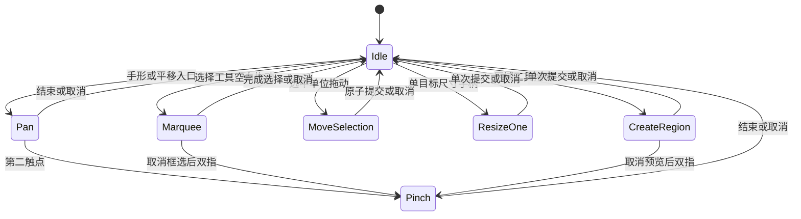

# Nav 无限画布 V2 完整实施方案

日期：2026-10-18，Asia/Shanghai。  
状态：实施设计，尚未实施 V2、创建分支、修改仓库、合并或部署。  
输入：用户提供的《Nav 无限画布 V2 开发上下文》及本次核对的 V1 源码、文档、PR 和 CI。  
目标：在 V1 的稳定空间底座上，完成“选择、组织、整理、找回”四类能力。

## 1. 接手基线与前置条件

### 1.1 已核实的事实

| 项目             | 本次核实结果                                                                                                   |
| ---------------- | -------------------------------------------------------------------------------------------------------------- |
| 仓库             | `wymix-tech/Nav`                                                                                               |
| V1 分支          | `feat/infinite-canvas-v1`                                                                                      |
| V1 头部          | `d79ac926857418b901c885a55377438beaeae398`                                                                     |
| PR #2            | open、draft，尚未合并                                                                                          |
| main             | `27e915f1f33692fa8c90b8736974255d0b73eff9`，尚不含 V1                                                          |
| 最新已核实 CI    | run `39130620997`，上述 V1 提交，结论 failure                                                                  |
| CI 步骤          | pnpm check 成功；三浏览器开发回归失败；后续生产回归和 Docker 构建跳过                                          |
| 附件中的验证记录 | 本地 54 项测试通过；Chromium 开发 17 通过／1 跳过，生产 18 通过；CI 开发矩阵 47 通过／5 跳过／2 个 WebKit 失败 |

V1 的功能实现已完成；全平台发布验收尚未闭环。方案以 V1 分支为代码基线，不在旧 main 上重做相机。实施时重新核对远端，若已合并则从包含该提交的最新 main 切分支；否则从 V1 新头部建立依赖分支 `feat/infinite-canvas-v2`，PR 暂以 V1 分支为 base，V1 合并后再变更 base、核对差异和重跑检查。

### 1.2 V1 遗留事项的处置

| 事项                                  | V2 前置任务                                            | 判定标准                                                 |
| ------------------------------------- | ------------------------------------------------------ | -------------------------------------------------------- |
| WebKit Docker access control 页面错误 | 保存日志、请求和取消时序，定位真实请求错误或测试桩问题 | 对应测试通过，保留 pageerror 检查，修复有回归证据        |
| 默认视角 centerY 约 0.208 偏差        | 用实际 ResizeObserver 尺寸和世界点投影交叉判断         | 区分产品错误与整数测量误差；断言依据明确，不能只放宽精度 |
| 后续生产回归和 Docker 跳过            | 补完整运行                                             | 有实际通过记录，不能以已配置代替执行                     |
| 100 时钟 p95 31.9／37.1／58.6ms       | 约定参考设备、分析定时器与渲染、建立对照样本           | 分清容器与实机结果，不能标成稳定达到 ≤33ms               |
| 真机与迁移                            | 补 Safari、触控板、触屏和部署副本演练                  | 记录环境、结果、限制与备份恢复证据                       |

前两项作为开发基线闭环任务优先处理；V2 设计和纯函数开发可继续。V1/V2 发布前必须完成相应门槛，不通过提前裁剪组件绕过运行状态保护。

## 2. 范围、默认决策和非目标

### 2.1 必交范围

| 能力         | V2 明确采用的语义                                               |
| ------------ | --------------------------------------------------------------- |
| 框选、多选   | 显式选择工具；相交命中；Shift 增减选；单层组按整体选取          |
| 批量编辑     | 移动、删除、对齐、等距分布；一次操作一次原子文档提交            |
| 分组         | 单层逻辑组，至少两个成员；无 DOM 容器迁移；组内组件保留世界坐标 |
| 区域框       | 独立背景注释矩形，无成员和自动归属；移动区域不带动组件          |
| 层级         | 图层面板、前移／后移／置顶／置底；组作为层序块                  |
| 锁定         | 保护几何、删除、组成员关系；允许内容操作、改名和显式层序管理    |
| 智能对齐     | 拖动时边缘／中心／等距参考；工具栏六向对齐与水平／垂直等距分布  |
| 搜索定位     | 显式可搜索字段、组件／组／区域结果、当前视图内定位              |
| 多个命名视角 | 本机私人相机快照；新增、覆盖、改名、删除、跳转                  |

以上是本方案选定的实现默认值，不将附件中的“建议”描述成已实现功能。无需额外选择即可按本文实施；用户后续调整语义时，先更新模型、命令和验收。

### 2.2 不计入本期

复制粘贴、旋转、嵌套组、组内独立几何编辑、多选缩放、区域容器及成员跟随、共享命名视角、内容目标追踪视角、跨设备私人视角同步，不计入必交。

V3 的视口裁剪、分级显示、空间索引、运行状态全面外置、增量同步和空间分块继续独立。V2 不引入 CRDT、多人协作、通用连线或新画布引擎；widgets 上限维持 100。

## 3. 必须保持的 V1 不变量

1. 一个世界单位在 100% 下等于一个 CSS px；沿用既有坐标转换，不乘 devicePixelRatio。
2. 相机、选择、搜索跳转、工具和辅助线不写共享文档，不进入文档撤销和同步队列。
3. 预览只在内存，pointerup 使用最终位置计算；取消没有文档提交。
4. 所有几何手势共用一个所有权控制器，不添加互相竞争的 pointer 全局监听体系。
5. 世界坐标、组件 ID、既有默认相机、网格布局和运行实例保留。
6. 分组、解组、层序、锁定和导航不移动组件到新的 DOM 父节点，不重新挂载聊天或 iframe。
7. 保留相机 serial 竞态修复、原子快照、If-Match、稳定操作 ID、generation、lease、离线备份和实例隔离。
8. 无关组件远端增删不取消 pan／wheel；只对活动编辑目标失效做局部取消。
9. 认证和插件隔离继续有效；编辑锁只是布局保护，不是访问控制或内容保密功能。

## 4. 共享文档模型

### 4.1 版本决策

| 层次                         | V1       | V2 方案                  |
| ---------------------------- | -------- | ------------------------ |
| 产品版本                     | V1       | V2                       |
| documentVersion              | 2        | **3**                    |
| 请求 schemaVersion／能力头   | 2／`'2'` | **3／`'3'`**             |
| canvasSettings.version       | 1        | 保持 1，默认相机结构不变 |
| canvasScene.version          | 无       | 新增 1                   |
| 网格 layoutVersion           | 2        | 保持 2                   |
| CanvasViewPreference.version | 1        | 保持 1，当前相机格式不变 |
| NamedView.version            | 无       | 新增 1                   |
| Dexie schema                 | 3        | **4**，仅增加命名视角表  |
| 插件 manifestVersion         | 2        | 保持 2                   |

升级请求和文档协议，是因为旧 V1 客户端不理解组、锁和层序，可能写入缺失或失效的组织结构；仅增加可选字段不能保证安全。

### 4.2 类型草案

```ts
interface CanvasWidgetMeta {
  title: string // 可为空；为空时显示统一解析的组件类型名
  locked: boolean
}

interface CanvasGroup {
  id: string
  title: string
  // 按从后到前的内部层序排列，只引用真实 widget ID
  memberIds: string[]
  locked: boolean
}

interface CanvasRegion {
  id: string
  title: string
  x: number
  y: number
  w: number
  h: number
  color: 'slate' | 'blue' | 'cyan' | 'green' | 'amber' | 'orange' | 'rose' | 'violet'
  locked: boolean
}

type CanvasLayerRef = { kind: 'widget'; id: string } | { kind: 'group'; id: string }

interface CanvasScene {
  version: 1
  widgetMeta: Record<string, CanvasWidgetMeta>
  groups: CanvasGroup[]
  // 区域在独立背景平面；此数组从后到前排列
  regions: CanvasRegion[]
  // 内容平面从后到前：每个自由组件或组恰好出现一次
  layers: CanvasLayerRef[]
}

interface Dashboard {
  documentVersion: 3
  canvasScene: CanvasScene
  // 继续保留 V1 的其他字段：widgets、canvasSettings、layouts 等
}
```

这是新增字段的类型说明，不是删除现有 Dashboard 字段后的完整替代接口。

### 4.3 模型选择理由

- widgets 仍是唯一运行组件集合；组和区域不是插件实例，不写入 installed widget 引用。
- 组件几何仍在 widget.canvas；不在组里存第二套成员坐标。
- 组包围盒从成员矩形动态派生，不保存 x/y/w/h，不维护两份真相。
- 成员关系只保存在 group.memberIds；不再给 widget 写重复 groupId。
- 层序只有 layers／memberIds 两级，按层序展开为 widget 的 rank；不再维护易冲突的任意 zIndex 数值。
- 宿主按原 widgets 数组和稳定 key 渲染，只通过 CSS z-index 改前后顺序。

例：A、B 组成 G，C 自由，layers 为 `[G,C]`，G.memberIds 为 `[A,B]`，展开层序为 A、B、C。组始终作为连续层序块，C 不会插入 A 和 B 中间。

### 4.4 数量、引用和内容校验

| 内容       | 约束                                                                                |
| ---------- | ----------------------------------------------------------------------------------- |
| widgets    | ≤100，沿用现有组件和配置校验                                                        |
| widgetMeta | key 集合与 widget ID 集合完全一致，不允许孤儿或缺失记录                             |
| groups     | ≤50；每组 2～100 成员；全局成员总数≤100；一个组件最多属于一组                       |
| regions    | ≤50；每个区域独立矩形，没有 memberIds                                               |
| layers     | 恰好覆盖全部自由组件和全部组；不得引用组内组件、区域或未知 ID；不得重复             |
| ID         | 稳定 UUID 或沿用合法旧 ID；组／区域 ID 与组件 ID 全局不重名；拒绝保留键             |
| 标题       | 纯文本，trim；组件允许空，组／区域非空；最多 80 Unicode 码点                        |
| 颜色       | 固定枚举，不接受 HTML、CSS 或任意样式对象                                           |
| locked     | 必须为 boolean，不以缺失表示默认状态                                                |
| 组件几何   | 沿用 CANVAS：位置±1,000,000，w/h≤16,384，编辑受 minSize 约束                        |
| 区域几何   | w/h≥40；端点在 [-positionLimit, positionLimit+maxSize]；w/h≤2×positionLimit+maxSize |
| 其他总量   | 保持结构 50,000 节点／深度 32、配置 16KiB、API 2MiB、历史 50 条                     |

区域可能覆盖多个相距较远的组件，因此不能套用单组件 maxSize=16,384。区域与组件使用不同矩形校验函数。组包围盒是派生范围，也不套用单组件尺寸限制。

前后端调用同一结构校验。非法输入报错并保留源数据；正常读取不能悄悄去重、删成员或重建层序掩盖损坏。删除引起的引用清理由明确命令负责。

## 5. 状态归属与模块结构

| 状态                                 | 归属                              | 文档同步／历史 |
| ------------------------------------ | --------------------------------- | -------------- |
| widgetMeta、groups、regions、layers  | Dashboard.canvasScene             | 是             |
| 组件世界几何和配置                   | 现有 widgets                      | 是             |
| camera／presentation                 | 现有 viewPreferences 和标签页会话 | 否             |
| selectedRefs、marquee、draft、guides | 选择会话内存                      | 否             |
| 搜索词、搜索结果、高亮、面板展开状态 | 会话内存                          | 否             |
| 命名视角                             | 新增本机 namedViews 表            | 否             |

建议新增／扩展：

| 模块                                         | 职责                                     |
| -------------------------------------------- | ---------------------------------------- |
| shared/canvas/scene.ts                       | 关系索引、组边界、层序展开、ID 规范化    |
| shared/canvas/selection.ts                   | 框选命中、选择单位和组件 ID 展开         |
| shared/canvas/commands.ts                    | 纯文档命令，原子增删、分组和层序清理     |
| shared/canvas/alignment.ts                   | 共同 delta、吸附、对齐、等距分布         |
| shared/canvas/transition.ts                  | 锁定状态下的文档转换校验                 |
| shared/canvas/migration.ts                   | 显式升级到文档 3，保留原相机迁移         |
| canvas/useCanvasSelection.ts                 | 选择状态和框选预览，不拥有第二套手势监听 |
| canvas/useCanvasInteraction.ts               | 扩展现有状态机，管理所有手势             |
| canvas/useCanvasSearch.ts                    | 纯文本索引、排序、定位编排               |
| canvas/namedViewService.ts                   | 命名视角事务和并发版本检查               |
| canvas/resolveCanvasLabel.ts                 | 图层／搜索／无障碍名称的统一解析         |
| components/canvas/CanvasSelectionOverlay.vue | 选择边框、批量移动手柄、屏幕尺寸控件     |
| components/canvas/CanvasRegionLayer.vue      | 区域背景与标题／编辑手柄                 |
| components/canvas/CanvasGuides.vue           | 辅助线和间距说明                         |
| components/canvas/CanvasLayersPanel.vue      | 层序、分组、选择和锁定管理               |
| components/canvas/CanvasSearchPanel.vue      | 搜索结果和跳转                           |
| components/canvas/CanvasViewsPanel.vue       | 本机命名视角 CRUD                        |

CanvasGrid 负责组装，不承载上述全部逻辑。坐标转换、fit、clamp、网格吸附、组件最小尺寸、视角 key、认证和保存继续复用 V1。

新增纯函数应有真实调用方，不保留并行但无使用方的旧版本。v-memo 加入 selected、effectiveLocked、rank、目标 draft 等依赖；辅助线与框选单独渲染，不要求所有组件每帧重绘。

## 6. 选择工具与手势语义

### 6.1 工具与优先级

V2 提供“交互、选择、手形、区域”四个明确入口。浏览模式默认交互，进入编辑也先保留交互模式；选择和区域工具需要编辑权限。退出编辑恢复交互并清除编辑预览；搜索和视角浏览仍可用。

| 工具／入口 | 空白左拖     | 组件内容             | 用途                           |
| ---------- | ------------ | -------------------- | ------------------------------ |
| 交互       | 保留 V1 平移 | 原生点击、输入和滚动 | 日常使用；宿主移动手柄仍可编辑 |
| 选择       | 框选         | 宿主选择层接管       | 点击／框选／拖动已选对象       |
| 手形       | 平移         | 宿主覆盖层接管       | 跨 iframe 连续浏览             |
| 区域       | 新建区域预览 | 不将组件当成员       | 创建完成回到选择工具           |

优先级：对话框／dock／表单控件 → 正在进行的手势 → 中键／有效空格／手形 → 编辑手柄 → 当前工具背景行为。一个 pointerdown 只能进入一种手势。

选择工具下双击组件，或点击“进入组件”，回到交互工具并把焦点送至宿主；插件内部由用户自行点击。不能假定父页面能读取 iframe 内部焦点或事件。

### 6.2 选择单位

- 自由组件是一个单位，组是一个单位，区域是一个单位；组内组件不能再独立同时选中。
- 单击未选中单位替换选择；Shift＋单击切换该单位的选中状态；空白单击清空。
- 框选默认与自由组件矩形或组包围盒相交即选，正反方向一致；仅接触边界、不产生正面积相交的不算命中。
- Shift 框选对开始时选择集合做并集；不随每帧结果累计，避免拖回时仍残留选择。
- 框选不自动命中区域，避免覆盖背景区域导致意外整块选择；区域通过标题、边框或图层面板选中，支持 Shift 混选。
- 锁定单位可被选择、定位和检查；几何与删除命令按锁定规则整体拒绝。
- Ctrl/Meta＋A 仅在选择工具和画布／图层焦点下选全部内容单位，不包括背景区域；不劫持输入框和网页全选。
- Ctrl/Meta＋G 分组，Ctrl/Meta＋Shift＋G 解组，仅在命令有效且焦点属于宿主编辑环境时接管；所有动作另有可见按钮。
- Escape 首次取消活动手势并恢复手势前选择；无活动手势时清空选择。手形退出继续沿用 V1 规则。

普通点击与拖动用 5 CSS px 阈值区分。Shift 按下时先明确增减选结果；若目标被移出选择，本次不启动拖动。V2 不给 Shift 额外增加方向约束语义。

### 6.3 触屏与取消

触屏通过显式选择工具进入单指框选／选择拖动；手形工具保持单指平移。两指操作开始前取消尚未提交的框选或区域预览、恢复原选择，再进入现有 pinch；不能把第二指解释成另一个编辑操作。多选通过可见“增减选择”开关实现，不依赖修饰键或长按。



Escape、pointercancel、非预期 capture 丢失、blur、权限失效、根容器／文档／presentation 切换均取消未提交预览。切换时释放 capture、清理 RAF、辅助线和触点集合，正常 pointerup 释放不能反触发取消。

## 7. 批量原子命令与历史

### 7.1 命令入口

```ts
type CanvasCommand =
  | { type: 'move'; refs: SelectionRef[]; delta: Point }
  | { type: 'delete'; refs: SelectionRef[] }
  | { type: 'group'; widgetIds: string[]; title: string }
  | { type: 'ungroup'; groupIds: string[] }
  | { type: 'set-lock'; refs: SelectionRef[]; locked: boolean }
  | { type: 'reorder'; refs: SelectionRef[]; action: LayerAction }
  | { type: 'align'; refs: SelectionRef[]; axis: AlignAction }
  | { type: 'distribute'; refs: SelectionRef[]; axis: 'x' | 'y' }
// 区域创建/修改、改名、组成员管理等也使用同一命令入口
```

SelectionRef 是 kind＋id 的判别联合，引用 widget、group 或 region；组展开为成员时去重，禁止将相同组件算两次。

执行顺序：获取最新本机文档 → 权限、工具、目标存在性和锁检查 → 根据同一快照生成 next → 清理引用 → 结构及转换校验 → 判断是否真实变化 → 一次 commit(next)。无变化不增加历史／队列。不能循环调用 N 次 updateCanvas/removeWidget 模拟批量原子操作。

一次命令至多增加一条历史和一次逻辑保存；HTTP 网络重试仍使用同一不可变操作 ID。文档撤销最多 50 条，恢复整批几何、成员关系、锁和层序；不回退相机或命名视角。

新增组件也必须经过同一应用入口：沿用 V1 落点与尺寸算法，原子添加 widget、默认 widgetMeta 和 layers 顶部的自由组件引用，然后本机选中新组件。默认不加入当前组选区或所在区域。组件库不能只 push widgets，造成新文档校验失败；任一普通删除入口都需同时维护层序和成员引用。

### 7.2 共同 delta 与边界

成员 i 的合法 x 区间为 [Li,Ui]，原位置为 xi，则共同 dx 的合法区间为 `[max(Li-xi), min(Ui-xi)]`；y 同理。组件和区域使用各自边界。将同一 raw delta 限制到交集后应用给所有目标，保持相对位置。

吸附作用于选择包围盒的锚点／共同位移，不逐个把成员 x/y 四舍五入到网格。组成员原有不规则偏移在移动后保留。跨边界时先保证合法和相对位置，再显示可实现的辅助线；不显示并未达到的吸附结果。

### 7.3 手势与并发

开始几何手势保存目标 ID、几何、成员关系、相关锁和起始相机的指纹；预览为按 ID 索引的局部 draft，不保存整份过期文档。

pointerup 时用最终指针位置重新计算，并与最新本机状态核对。目标被删除、锁定、移动／调整尺寸或改变成员关系时，取消整批草稿，不部分提交。无关目标变化则基于最新文档应用本次几何 patch，保留无关修改；无关组件增删不能撤回 pan/wheel。

手势期间不允许另一个本机文档命令并行修改活动目标；点击菜单先取消或结束手势再执行。远端网络并发仍由 If-Match 和现有冲突流程处理，V2 不伪装成实时多人合并。

撤销／重做仍须校验权限和文档有效性。操作失败时历史栈和 future 的移动必须保持一致；持久化失败保留明确未保存状态，不能假装成功。发生外部文档替换或恢复后清空旧文档历史，选择按最新合法 ID 清理。

## 8. 分组与区域框

### 8.1 单层分组

- 至少选择两个未入组、可编辑且未锁定的组件；不支持把组作为成员，也不隐式把已有组合并成嵌套组。
- 创建组只写成员、名称、锁和层序，不改变任何成员世界几何。
- 组放到原选中成员中最靠前成员所在的位置；先从 layers 移除成员，再以锚点前剩余未选单位数量作为插入索引。内部 memberIds 保留原相对层序。
- 点击组中任意组件的选择覆盖层选中整组；拖动组统一移动成员；组包围盒采用成员矩形并集，视觉边框 padding 不参与几何。
- V2 不提供组整体缩放。要独立调整成员几何，应先解组；组件内容、配置和交互仍可正常使用。
- “解组”删除组记录，将成员按内部顺序放回组所在 layers 位置；不删除组件、不改变坐标。
- “删除组及组件”显式删除全部成员及引用；图层菜单分别列出“解组”和“删除组及组件”，避免歧义。
- “加入此组”仅在选择恰好一个组和若干自由组件时可用；新成员按原层序追加到组顶端，组的外层位置不变。
- “从组移出”通过图层面板指定成员，移出的组件按原内部顺序放在组后；组剩余不足两个时自动解散，并在同一次命令内完成。
- 锁定组或含锁定成员时，移动、删除、解组和成员修改全部拒绝；先显式解锁，不静默跳过成员。

### 8.2 独立区域注释

- 区域是背景矩形，可命名、改色、移动、调整大小、锁定和删除。
- 用户用区域工具拖出矩形，达到最小尺寸后释放创建一次；过小取消，不生成零尺寸对象。
- “框住所选”按钮可按所选组件／组的联合范围加 24 世界单位 padding 创建区域；若越界则限制到合法范围并说明结果，不能移动组件适配区域。
- 区域没有成员；组件进入／离开、移动区域、删除区域均不改变其他组件。
- 区域背景不抢组件输入；只有标题、边框、显式手柄和图层条目可选中区域。
- 区域独立在内容平面下方，不能置于运行组件上方遮挡内容；区域之间支持层序操作。
- 区域参与搜索、小地图和适应全部，空区域也参与。超大跨度仍使用 V1 的最小倍率与提示。
- 列表视图不渲染大背景框，在组织面板列出区域并允许定位、改名；不据区域给组件重新排序或分配归属。

## 9. 层序、锁定和其他模式

### 9.1 图层面板与前后顺序

图层面板显示内容平面和区域背景平面；内容平面以组／自由组件展示，组可展开查看成员，结构最多两层。支持点击、Shift 选择、名称、锁状态和前后操作，键盘按钮提供全部必要功能；拖拽排序可作为同一已定义命令的入口，不新增第二套排序语义。

单步前移／后移按未选邻居交换选中块，保持选中项相对顺序；置顶／置底使用稳定分区。混合内容与区域选择不支持一次层序命令，提示分别操作；单一平面批量层序一次提交。

内容层和背景层有独立 CSS stacking context，rank 只在各自平面内生效；选择 UI、手形层、小地图、dock、对话框的层级是宿主固定配置。组件置顶不会覆盖宿主控件。

### 9.2 锁定规则

effectiveLocked(widget) = 自身 locked 或所属组 locked。组只要有锁定成员，整体几何／结构命令视为不可执行；锁定状态和阻止原因在图层面板可见。

| 操作                     | 锁定组件／组                       | 锁定区域                         |
| ------------------------ | ---------------------------------- | -------------------------------- |
| 浏览、搜索、定位、选择   | 允许                               | 允许                             |
| 内部点击、输入、配置保存 | 按原认证规则允许                   | 不适用                           |
| 改显示名、调整前后顺序   | 有编辑权限时允许                   | 有编辑权限时允许；颜色修改也允许 |
| 移动、调整尺寸           | 禁止                               | 禁止                             |
| 删除、加入／移出／解组   | 禁止                               | 删除禁止；无成员关系             |
| 显式解锁                 | 有编辑权限时允许                   | 同左                             |
| 多选包含锁定目标         | 整批几何／删除命令拒绝，不部分成功 | 同左                             |

编辑锁有意保护布局和结构，不禁止内容编辑。输入操作不能借助锁定规则获得原本没有的认证权限。

从宿主工具栏、键盘、批量命令、组件删除按钮、清空、插件卸载检查到网格入口都必须使用同一规则。组内组件的独立删除按钮禁用并说明需先解组；独立内容配置仍允许。清空全部遇到任一锁定对象时拒绝整次清空，先解锁；清空成功同时清理组、区域、层序和 widgetMeta。

服务端在操作 ID 去重和 revision 检查之后、落库之前运行共享转换校验：当前锁定对象不能在 next 中被移动、改尺寸、删除或改变受保护成员关系；同一请求先解锁再移动不允许，解锁需成为前一条明确命令。内容配置、名称、层序差异按上表放行。认证仍是安全边界，编辑锁不是安全承诺。

转换比较中，成员“归属关系”和“内部层序”分开判断：成员集合／所属组改变属于受保护结构，单纯顺序改变属于显式层序管理。组件保护范围包括 canvas 和已保存的网格 layouts；有效组锁应展开到成员。锁定自身的切换可单独提交，不能因允许修改 locked 字段而忽略同请求里的受保护变化。

### 9.3 网格与列表

- grid/canvas 切换保留 canvasScene，不清空组织元数据；区域和组整体几何编辑仅在空间模式开放。
- 网格中组件按原布局呈现，组关系和层序保留但不改变网格布局；组件删除、组关系和锁仍受保护。
- 网格显式几何编辑、设为基准、整理等若会改写锁定组件的存储布局，整次命令拒绝并说明；单纯响应窗口派生显示不属于文档修改。
- 画布列表保持 V1 的 y/x/id 派生顺序，CSS order 展示；不因分组重排实际 DOM，也不把层序当列表顺序。
- 列表支持通过宿主选择按钮／图层面板选择、改名、锁定、删除、分组／解组；框选、移动、尺寸、对齐／分布仅空间视图可用。
- 有内容改变的模式切换仍按原文档命令执行；本机 spatial/list 切换仍不写文档。

## 10. 智能吸附、对齐和等距分布

### 10.1 拖动吸附

选择边界的左／中／右与上／中／下作为锚点。未选自由组件、组的派生边界和区域边界作为参考；锁定对象可以作为参考。排除选择自身及展开成员，组成员不再重复作为独立参考。

规则集中配置：进入阈值 6 CSS px，保持阈值 10 CSS px；转为世界距离时除以 zoom。参考来自当前可见范围向外扩展 64 CSS px 内的对象，避免吸附遥远目标；现有上限下使用线性遍历，不引入空间索引。

每个轴独立决策：有效保持的辅助线优先 → 距离最小 → 边缘、中心、等距的固定类型顺序 → 稳定参考 ID。命中智能候选时使用智能结果，否则回退既有 20 世界单位网格；不先后叠加两次吸附。Alt 拖动临时关闭智能和网格吸附，继续保留边界约束；移动端有可见吸附开关。

智能等距候选限定为选择框位于两参考对象之间、相邻方向不重叠、横向／纵向投影构成有效通道的情况；按两侧剩余间隙相等求候选。最多取 24 个最近参考单位生成配对候选，确定性限量，不对全部对象无限组合。辅助线只显示实际采用的结果。

批量移动只吸附联合包围盒，以共同 delta 应用；单组件 resize 仅对活动右／下边缘吸附，仍受 minSize/maxSize 约束。组／多选没有 resize；区域单目标 resize 使用区域边界。取消和手势结束清除辅助线，不产生独立历史。

### 10.2 工具栏几何整理

六向对齐：左、水平中心、右、上、垂直中心、下。至少两个选择单位，按所选联合包围盒对齐；组作为整体平移，尺寸不变。混选区域时将其当独立矩形处理。

等距分布至少三个单位；按轴起点、另一轴起点和稳定 ID 排序。保持首尾单位位置，按真实尺寸计算边缘间距：`gap = (lastEnd - firstStart - sum(size)) / (N-1)`。负 gap 时拒绝并提示空间不足，不主动制造重叠。

显式对齐／分布不再套网格吸附，允许合法小数坐标；若任一目标越界或锁定，整次命令拒绝，不能各自 clamp 破坏结果。布局约束均满足时一次提交；同结果不产生空历史。

## 11. 搜索与定位

### 11.1 索引与范围

搜索完全在当前已加载数据中进行，不发送查询到外部服务。

| 对象     | 允许索引的字段                                                                           |
| -------- | ---------------------------------------------------------------------------------------- |
| 组件     | scene.widgetMeta[id].title、widget ID、widgetId、内置类型名或已安装 manifest.displayName |
| 书签组件 | 额外包含已验证的 config.groups[].name、bookmarks[].title／url；聚合成该组件一个结果      |
| 组       | 组名称；成员匹配由对应组件结果表示                                                       |
| 区域     | 区域名称                                                                                 |

不直接 JSON.stringify(config) 建索引，不搜索聊天历史、正在输入的内容、令牌、插件任意配置或 iframe DOM。实例标题为新增的显式共享显示字段，UI 保存时说明会随公开仪表盘展示；默认空标题使用统一类型名，不要求迁移用户业务配置。

查询最多 128 Unicode 码点、最多 8 个词；NFKC、trim、压缩空格、忽略大小写，按词 AND 匹配。标题完全匹配优先，其次前缀、子串、类型与书签内容；同分按类型和稳定 ID 排序。120ms debounce，最多 200 个实体结果，不把每条书签都作为实体结果。

### 11.2 定位行为

- 组件结果使用组件矩形；组结果使用成员联合范围；区域结果使用区域矩形。
- 导航调用现有 fitBounds／camera，扣除停靠面板占用。清理活动预览后设置相机，给予约 1.5 秒宿主高亮。
- 分组内组件可以作为搜索结果定位和高亮，但编辑选择归一为所属组；不因此进入组内独立几何编辑。
- 列表中的组件结果滚动到原宿主；组结果滚动到列表里第一个成员，并高亮成员；区域结果明确提供“在空间中定位”，只切本机 presentation。
- grid 模式只直接定位可见组件；组／区域可显示信息，但提示切换到画布后再做空间定位。搜索不能偷偷修改共享 layoutMode。
- 搜索结果显示后对象被删除，点击时重新核对 ID，提示目标已不存在并更新结果；不使用过期边界。
- 访客可搜索公开内容并定位；进入编辑仍走现有认证。查询、选中结果、fit、高亮都不增加文档历史或同步。
- 提供一次“返回定位前视角”，仅内存保存，不新增共享导航历史。

默认使用工具栏搜索按钮和宿主焦点下 `/` 打开搜索；输入框／对话框／iframe 的按键不接管。结果支持上下方向键、Enter 和 Escape，关闭后恢复触发位置焦点。

## 12. 本机命名视角

### 12.1 模型与交互

```ts
interface NamedView {
  spaceKey: string
  id: string
  version: 1
  name: string
  nameKey: string
  camera: CanvasCamera
  revision: number
  createdAt: string
  updatedAt: string
}
```

UI 命名为“我的视角（此浏览器）”。每个空间最多 50 条；名称非空、最多 80 Unicode 码点，nameKey 使用 NFKC＋trim＋压缩空格＋小写归一化，同空间不重名。

必交操作：保存当前视角、按当前相机更新既有视角、改名、删除、跳转。保存的是 camera 数值，不保存选择、查询或 presentation，也不保存组／区域目标 ID；内容移动之后视角仍指向原空间位置。更新视角和改名是不同按钮，避免改名意外覆盖 camera。

跳转前结束／取消当前手势，调用统一相机接口，在空间视图打开；不得更改共享 grid/canvas 模式。处于 grid 时命名视角入口说明需要画布模式，不能靠提交模式修改完成跳转。相机倍率和中心使用 V1 校验与边界。

私人表示不进入服务端文档、API 和同步；同一浏览器配置文件的使用者仍可能共享本机记录，不将其描述成账户级权限隔离。访客可在自己的浏览器保存视角，不获得文档编辑权限。

### 12.2 存储、并发和版本

- Dexie schema 4 新增 `namedViews: '[spaceKey+id],spaceKey,&[spaceKey+nameKey]'`；旧表不重建，viewPreferences.version 仍为 1。
- spaceKey 复用 viewSpaceKey：server 使用确认的 instanceId＋dashboardId，standalone 复用持久 UUID；不生成新的独立空间身份。
- 服务身份尚为 unconfirmed 且无有效缓存时禁用命名视角持久保存，避免记录落到含混空间；浏览仍可继续。
- CRUD 在单条 IndexedDB 事务中完成，按行 revision 做比较后更新，创建／改名由唯一索引检查重名；多个标签页不整表覆盖。
- 当前相机的 300ms 写入不写 namedViews，命名视角 CRUD 也不整行重写 viewPreferences，从结构上避免迟到写入清空命名视角。
- 同空间跨标签页更新只刷新视角列表，不让另一标签页相机跟随。其他标签页抢先更新／删除同一条记录时提示重新读取，不无条件覆盖。
- 已知版本校验失败时保留原始记录并提示；未知未来 version 不降级、不覆盖。坏的一条不能导致其他有效视角全部消失。
- 私人记录保留在专用表中；若以后增加其修复备份，也不能写入会被现有文档 exportData 一并导出的通用 backups 表，否则会破坏私人数据与文档导出的边界。
- 现有文档导出不混入命名视角。V2 不新增私人视角导出／导入；需要转移时可在后续增加独立、显式的功能。

## 13. 稳定宿主、界面与可访问性

### 13.1 渲染层次

世界背景点阵 → 区域背景 → 运行组件平面 → 几何选择／对齐显示 → 手势接管层 → 小地图／宿主面板／dock → 对话框。

区域和组件共享同一世界变换；选择边框、线条、按钮保持合适 CSS px 大小，不能在 1% 下小到不可点击，或在 800% 下放大成遮挡。屏幕叠加层复用 worldToScreen 生成位置，不能重复计算不同坐标公式。

组件宿主始终从 dashboard.widgets 以稳定 widget ID 同父级渲染；layers 展开只生成 rank map，不 sort 原数组，不用 group ID 拼接 widget key。DOM 不因分组／改层序重挂。v-memo 显式覆盖锁、选中、rank、局部 draft 等新依赖，验证样式实际刷新。

导航和框选期间不每帧 clone Dashboard、不持久化、不重建搜索索引；几何 draft 只影响活动目标。搜索索引和关系索引在相关文档字段变化时更新，反应链不订阅每帧相机。

### 13.2 面板布局

组件库沿用原停靠槽；图层／搜索／视角复用一个右侧面板槽，一次打开一个。大屏可停靠并实际扣除视口，窄屏使用抽屉；同类面板切换尽量保持槽宽高，避免一连串容器尺寸变化。

面板开合导致根容器变化时沿用 V1 取消预览规则，不在手势中隐式挤压视口。拖动／框选期间不因选中数量自动展开面板。批量操作工具栏放在预留 dock，不遮挡目标或抖动画布。

### 13.3 无障碍与错误

- 图层条目使用可聚焦按钮／列表，展开组设置 aria-expanded；锁、名称和成员数有可读标签。
- 所有关键动作提供可见按钮，不仅靠快捷键和右键菜单；禁用操作显示具体原因。
- 删除组明确说明会删除哪些成员；解组使用不同文案。锁定混选提示阻止项数量，不默默部分执行。
- 批量操作完成／取消、锁定阻止、定位成功使用简短 live region，不在每帧播报坐标。
- 尊重 reduced-motion；不依赖长相机动画完成定位。区域名称按文本输出，不使用 v-html。
- 当前相机、本机命名视角、文档保存失败分开显示；本机视角失败不设置文档 unsaved 或阻断文档同步。

## 14. 文档迁移、旧客户端与离线恢复

### 14.1 显式迁移到文档 3

新共享入口以 schemaVersion=3／documentVersion=3 为写入要求，能力头为 `X-Nav-State-Schema: 3`。前端必须先确认精确支持版本；不能把 `>=3` 当成未来协议兼容。

版本 2 → 3 迁移：

1. 先验证有效 V1 文档；保留全部 widgets、canvas、originalW/H、layouts、canvasSettings、背景和布局设置。
2. scene.widgetMeta 为每个现存组件生成 `{title:'',locked:false}`。
3. groups／regions 为空；layers 按现有 widgets 数组顺序生成自由组件引用，保留原同层绘制顺序。
4. documentVersion 改为 3，canvasScene.version 为 1；其他独立版本保持不变。
5. 不重新运行相机初始化，不重新排列已有世界坐标，不重写 viewPreferences。

更老文档使用现有网格／相机迁移纯函数链补齐版本 2，再升到 3；同一次显式迁移事务只增加一次 revision。现有 migrateCanvasDocument 中硬编码版本 2 的返回逻辑应拆成明确的版本分派，避免读到 3 后仍抛错。未来未知版本停写，不自动回退为 2 或空 scene。

服务端增加计划命令 `canvas-v2-preflight`、`canvas-v2-dry-run`、`canvas-v2-migrate`，沿用当前维护程序风格。名称须实现并写入 package/docs 后才作为可执行命令交付；不得只在文档中列出不存在的 CLI。

所有维护命令要求数据库路径已存在，preflight 不创建空库；dry-run 回滚全部预演文档写入。apply 按文档事务保存原数据库行和 state_json，备份键 `canvas-scene-v2:<dashboardId>:<sourceRevision>`，升级、验证和 revision+1 同时提交。重复迁移不新增版本；失败文档完整回滚，全部文档成功前不开放写入。

standalone 在 IndexedDB 事务中备份并升级当前文档；namedViews 表的数据库结构升级和文档内容迁移各自有清晰版本，不因新增表而重置本机相机或空间 ID。

### 14.2 新旧客户端矩阵

| 客户端／服务端               | 行为                                                                         |
| ---------------------------- | ---------------------------------------------------------------------------- |
| V1 客户端 → V2 服务端        | 状态写入返回 426；不接受剥离 scene 的旧快照；旧客户端读取失败可提示刷新      |
| V2 客户端 → V1 服务端        | 精确能力探测不匹配，保留草稿、暂停发送；允许受控读取旧内容候选，不宣称已同步 |
| V2 客户端 → 已迁移 V2 服务端 | schema 3＋document 3＋认证＋If-Match＋operationId                            |
| V2 客户端 → 未迁移旧文档     | 提示管理员显式迁移，GET 不执行持久升级                                       |
| 任意客户端 → 未知未来文档    | 拒绝降级写入，保留本地数据和导出入口                                         |

apiClient、能力探测、SyncAdapter、LocalAdapter、共享校验、维护 CLI、服务端 PUT 和恢复预览统一更新，不能只修改 TS interface。当前幂等历史仍有效；schema 3 请求重试在操作去重后再做转换检查，避免已成功的锁定等操作因当前状态改变而被误拒绝。

### 14.3 旧 pending 与恢复

复用 V1 的隔离机制，识别条件从“不是版本 2”提升为“不是当前支持的写入版本”；未来文档不当作可自动转换的旧数据。旧 Operation 的 ID 和 snapshot 原样保留，不能补 scene 后用同 ID 重发。

旧 SyncRow、pending、conflict、revision、generation、lease 全量备份，状态进入 upgrade-required。文档可显示纯转换后的候选，但旧队列不自动发送。隔离期间的新增编辑额外保留，不覆盖唯一旧备份。

恢复预览获取最新远端并按 ID 展示：

- 全部原有共享设置和组件配置／几何差异。
- 组件显示名和编辑锁。
- 新增／删除组、成员变更、组名／锁变化。
- 区域新增／删除、矩形、颜色、名称和锁变化。
- 外层 layers 和组内部成员顺序变化。

比较使用规范化结构和稳定字段顺序，不能仅以对象键顺序差异报变更；也不能只比较组／区域数量漏掉同数量换成员。预览截断时说明还有多少变化，完整双方快照仍可导出。

采用远端／重新提交本地继续保留双方备份。旧草稿的 scene 为空而远端已有组织结构时，必须明确显示整盘采用本地将移除哪些组／区域／锁，不能自动假装合并成功。重新提交使用最新远端 revision、instanceId 和新 operationId；再次并发变化仍按 412。

恢复也遵守当前远端布局锁；若候选会修改受保护对象，先在远端文档明确解锁并重新读取，再重新核对恢复预览。不能在同一恢复请求中隐式解锁后修改。V2 不新增绕过锁的隐藏写入模式。

多标签页迁移和恢复继续用事务、generation 与租约；一方处理后另一方停止旧操作并提示刷新。恢复新文档后清空旧历史、清理失效选择，相机保持本机状态。

### 14.4 导出与数据库权威

state_json 是完整组织结构的权威；旧 widget 行和兼容相机列继续维护可表达的旧字段。组／区域不能伪装成 widget 写入兼容表；从权威快照导出／恢复时必须带完整 canvasScene。

管理员备份 API 加入新迁移备份键。现有 exportData 保留 dashboard、backups、sync，新元数据随文档和双方快照保留；namedViews 不混入公开文档导出，备份中历史凭据的认证保护保持不变。

## 15. 实施顺序、任务与具体入口

一个统一分支按阶段提交；每个阶段必须有测试证据，中间提交不单独部署。

| 阶段 | 任务                                         | 主要代码入口                                                              | 完成条件                                                    |
| ---- | -------------------------------------------- | ------------------------------------------------------------------------- | ----------------------------------------------------------- |
| P0   | V1 CI 闭环、固定接手提交和旧数据样本         | tests/browser、V1 验证文档、CI                                            | 两项 WebKit 结论明确；生产／Docker 有实际结果；基线证据更新 |
| P1   | 模型、限制、关系索引、层序、锁转换校验       | shared/types/dashboard、canvas、validation、index                         | 合法引用、坏数据和纯函数测试通过                            |
| P2   | 协议 3、显式迁移、队列隔离和恢复预览、偏好表 | migration、Local/SyncAdapter、localDatabase、server routes/db/maintenance | 旧写入受保护；升级幂等；原草稿可恢复                        |
| P3   | 统一命令、批量 delta、历史、引用清理         | shared/canvas/commands、dashboardStore、App                               | 一个命令一次保存；无变化不写；删除和清空无悬空引用          |
| P4   | 选择工具、框选、多选、批量移动和取消         | useCanvasInteraction、Selection、CanvasGrid、overlays                     | 工具优先级、混选和取消测试通过；输入／iframe 不被劫持       |
| P5   | 分组、区域、图层面板和锁定全部入口           | RegionLayer、LayersPanel、WidgetWrapper、DashboardGrid                    | ID／世界坐标／运行实例稳定，锁没有常规入口绕过              |
| P6   | 智能吸附、对齐、分布                         | shared/alignment、useCanvasInteraction、Guides、dock                      | 倍率手感一致、共同 delta 不变形、命令可撤销                 |
| P7   | 搜索、名称编辑、命名视角                     | resolveCanvasLabel、SearchPanel、ViewsPanel、namedViewService             | 导航零文档写入，个人记录隔离、并发更新可判定                |
| P8   | 联调、性能对照、生产壳、升级／回滚演练       | tests、CI、docs                                                           | 验收矩阵完成，发布限制明确                                  |

依赖：P0 为可靠验证基线；P1→P2/P3；P2/P3→P4；P4→P5→P6；P2/P4/P5→P7；P0～P7→P8。实际提交可按文件内聚拆分，但一个共享模型变更必须同时带校验、序列化和迁移，不只完成界面。

### 15.1 复用和清理要求

| 当前入口                                       | V2 改动要求                                                                            |
| ---------------------------------------------- | -------------------------------------------------------------------------------------- |
| `CanvasGrid.vue`                               | 仅组装新模块；稳定 key、同父级宿主、v-memo 依赖、列表 CSS order                        |
| `useCanvasInteraction.ts`                      | 从单 id draft 扩展为 selection patch；统一 pan/pinch/marquee/move/resize/region        |
| `useCanvasCamera.ts`                           | 保留 serial/flush 竞态保护；定位和命名视角复用现有 camera                              |
| `geometry.ts`／`constants.ts`                  | 不复制坐标公式；增加共享矩形与阈值配置                                                 |
| `dashboardStore.ts`                            | 新增 applyCanvasCommand；旧 updateCanvas/remove/clear 通过同一规则或适配层，避免绕过锁 |
| `WidgetWrapper.vue`／`WidgetRenderer.vue`      | 区分内容 editable 与布局 canDelete/canMove，不因锁把整个组件强制只读                   |
| `SandboxWidget.vue`／`pluginRuntime.ts`        | 保留 CSP、通道、认证和挂载边界；组织变化不重启 runner                                  |
| `DashboardGrid.vue`／`PreferencesPanel.vue`    | 网格显式布局编辑和模式切换保留 scene，尊重布局锁                                       |
| `localDatabase.ts`／`viewPreferenceService.ts` | 原视角表不变，新增命名视角表；复用 key，不重置 UUID                                    |
| `syncAdapter.ts`／`apiClient.ts`               | 精确 schema 3；完整恢复比较、升级隔离、类型化返回                                      |
| `db/state.ts`／`routes/dashboards.ts`          | 协议、版本条件、幂等之后的锁转换校验、完整 snapshot                                    |
| `maintenance.ts`                               | 真实实现三个 V2 CLI、缺失路径拒绝、事务和原备份                                        |

旧的单组件移动／键盘入口可以包装成单元素命令，不能同时保留两套边界和保存逻辑。删除无调用方的旧事件、draft 字段、监听和 CSS；不为预期未来功能保留无使用方的扩展层。

### 15.2 文档交付

实施后新增 `docs/infinite-canvas-v2.md` 和 `docs/infinite-canvas-v2-validation.json`，记录实际行为、提交、测试环境、已通过／失败／跳过／未执行。将本方案落入 `docs/infinite-canvas-v2-plan.md`，并更新 README、升级回滚和当前协议约定。

方案是设计依据；操作文档和验证 JSON 才记录实际完成状态。插件协议 v2 的名称和含义保持独立，不能因产品 V2 重命名其协议。

## 16. 验收矩阵

以下 48 项是实施后的验收要求，不表示本次已执行。测试按行为组织，不为可逆文案和样式重复编写镜像测试。

### A. 选择和焦点

| ID  | 场景                                          | 通过标准                                   |
| --- | --------------------------------------------- | ------------------------------------------ |
| A01 | 1%、100%、800%、负坐标、双向框选              | 命中同一世界矩形；边缘接触规则一致         |
| A02 | 单击、Shift 切换、Shift 框选、Ctrl/Meta+A     | 集合确定，不重复成员、不自动框选区域       |
| A03 | 交互／选择／手形／区域、空格和中键            | 每次 pointerdown 只有一个手势所有者        |
| A04 | 输入框、聊天、contenteditable、对话框、iframe | 快捷键不劫持输入；显式覆盖层退出后正常交互 |
| A05 | 触屏增减选择、双指接管                        | 取消未提交预览后进入 pinch，零意外文档创建 |
| A06 | Escape／blur／capture 丢失／容器改变          | 恢复手势前选择，无残留触点、辅助线、RAF    |

### B. 原子批量命令

| ID  | 场景                           | 通过标准                                                 |
| --- | ------------------------------ | -------------------------------------------------------- |
| B01 | N 个组件／组／区域共同移动     | 相对位置不变，一次历史和一次逻辑保存                     |
| B02 | 原始坐标不对齐网格、靠世界边界 | 共同 delta 限制，无组内变形或逐项 snap                   |
| B03 | pointerup 早于待执行 RAF       | 使用最终指针位置，末帧不丢失                             |
| B04 | 混选锁定、目标缺失或成员改变   | 整批拒绝／取消，没有部分提交                             |
| B05 | 无关文档变化和活动目标变化     | 保留无关 patch；相关变化取消；pan/wheel 不被无关增删撤回 |
| B06 | 无变化、撤销／重做、保存失败   | 无空历史；整批恢复；失败状态与历史一致                   |

### C. 组织和层序

| ID  | 场景                           | 通过标准                                         |
| --- | ------------------------------ | ------------------------------------------------ |
| C01 | 非相邻组件分组／解组           | 组按既定锚点插入，内部顺序、ID、几何正确         |
| C02 | 加入／移出成员、剩一成员       | 同一命令清理引用，自动解散语义一致               |
| C03 | 解组与删除组、清空             | 解组不删组件；删除和清空清理全部关联元数据       |
| C04 | 区域创建／移动／删除／框住所选 | 区域不携带成员，组件几何不变，最小／最大范围合法 |
| C05 | 单步／置顶置底、混选平面       | 稳定顺序，组为块，跨平面不隐式混排               |
| C06 | grid/canvas、空间／列表切换    | scene 保留，列表顺序不受层序污染                 |

### D. 锁定和权限

| ID  | 场景                                   | 通过标准                                   |
| --- | -------------------------------------- | ------------------------------------------ |
| D01 | 自身锁、组锁、锁定成员                 | effectiveLocked 正确，整组几何和结构受保护 |
| D02 | 鼠标、键盘、菜单、删除按钮、批量和清空 | 同一布局保护规则，无常规入口绕过           |
| D03 | 锁定后内容输入／配置、改名／层序       | 按表允许且保持原认证；不把内容错误禁用     |
| D04 | 网格移动／整理／设为基准               | 不改写锁定布局；响应式派生显示不误阻止     |
| D05 | 权限在手势中失效、访客调用写入口       | 取消草稿，服务端拒绝无认证修改             |
| D06 | 服务端同请求解锁并移动、成功请求重试   | 前者拒绝；相同 ID/内容重试仍可幂等返回     |

### E. 对齐与吸附

| ID  | 场景                          | 通过标准                                     |
| --- | ----------------------------- | -------------------------------------------- |
| E01 | 不同 zoom 接近参考线          | 6px/10px 阈值按 CSS px 生效，结果稳定        |
| E02 | 多候选、网格竞争、Alt         | 决策确定；智能／网格不双重叠加；Alt 仍限边界 |
| E03 | 组／多选移动、resize 最小尺寸 | 共同 delta，不误缩放组；尺寸约束有效         |
| E04 | 左中右／上中下对齐            | 正确几何，不因网格二次改变结果，一次撤销     |
| E05 | 不同尺寸等距、负 gap、越界    | 保留首尾；边缘间距相等；非法结果整体拒绝     |
| E06 | 等距拖动参考、密集对象、取消  | 候选有上限；选中成员排除；不显示未采用的线   |

### F. 搜索与命名视角

| ID  | 场景                                 | 通过标准                                    |
| --- | ------------------------------------ | ------------------------------------------- |
| F01 | 组件标题／类型／书签／组／区域查询   | 只索引白名单字段，排序和数量确定            |
| F02 | 已删除目标、组内组件、列表区域、grid | 使用最新 ID；局部高亮；无隐式共享模式写入   |
| F03 | 保存、更新、改名、删除和跳转视角     | camera 快照语义，零文档历史／队列           |
| F04 | 同名、超限、坏记录、未来记录版本     | 明确失败，原记录保留，不清空其他视角        |
| F05 | 相机迟到写入、双标签页同条改名／删除 | 命名视角不被相机覆盖，revision 冲突可见     |
| F06 | 访客、服务器实例替换、standalone     | 浏览权限正确、空间 key 隔离、不进入公开导出 |

### G. 协议与迁移恢复

| ID  | 场景                                         | 通过标准                                       |
| --- | -------------------------------------------- | ---------------------------------------------- |
| G01 | 文档 2→3、重复执行、更老版本升级             | 旧 ID／几何／相机保留，revision 一次，显式迁移 |
| G02 | 缺失数据库、坏文档、缺失插件、迁移中失败     | 不创建假空库，事务回滚，保留备份和源数据       |
| G03 | 新旧客户端／服务端和未知未来版本             | schema 精确匹配、426、暂停发送和防降级         |
| G04 | 旧 pending 含已提交但丢回包操作              | ID／内容不改写，备份隔离、恢复用新 ID 和新版本 |
| G05 | 同数量换成员／换层序、双标签页恢复、锁定差异 | 预览完整，generation 防覆盖，锁定不被恢复绕过  |
| G06 | 非法引用／重复成员／循环意图／超限／原型键   | 运行时前后端一致拒绝；单层关系无嵌套容错降级   |

### H. 生命周期与整体回归

| ID  | 场景                                                 | 通过标准                                      |
| --- | ---------------------------------------------------- | --------------------------------------------- |
| H01 | 分组／解组／改层序／锁定，聊天流中与 iframe 临时状态 | 不卸载、不重挂 DOM、不重开流／消息端口        |
| H02 | 搜索、视角、工具、空间／列表切换                     | 组件 mount 计数不变，草稿和流保留             |
| H03 | 选择／锁定／rank/draft 变化                          | v-memo 不漏更新；相机变化不导致整盘逐帧渲染   |
| H04 | 新组织数据离线编辑、刷新和重连                       | 原子保存恢复，scene 不丢字段，冲突双方可导出  |
| H05 | SW 升级、旧队列、生产静态资源                        | 有恢复入口，无强制刷新或 pending 永久阻塞升级 |
| H06 | 三浏览器、参考设备、生产副本迁移与回滚               | 记录真实结果，跳过不算通过，证据可追溯        |

## 17. 测试组织与性能边界

### 17.1 复用现有入口

- tests/canvas.test.ts：几何、命中、共同 delta、对齐、层序和迁移；体量增加后按 scene／alignment 拆文件。
- tests/canvas-session.test.ts：所有权、选择生命周期、目标失效、批量提交与取消，保留原相机竞态反向回归。
- tests/storage.test.ts：新偏好表、命名视角 CAS、旧队列、恢复比较和多标签页。
- tests/server.test.ts／legacy-main.test.ts：schema 3、锁转换、显式迁移、备份和兼容行。
- 浏览器按 selection／organization／navigation／lifecycle 拆场景，保留原 dashboard 和 offline-shell 回归，不把所有 V2 测试继续塞进一个超长文件。
- 改动文件执行格式检查；docs JSON 额外显式检查，不能依赖现有脚本覆盖。

常用命令仍沿用仓库声明的 Node 22+ 和 pnpm 9.15.0：

```bash
corepack enable
pnpm install --frozen-lockfile
pnpm check
pnpm exec playwright install chromium firefox webkit
NAV_TEST_BROWSERS=chromium,firefox,webkit pnpm test:browser
NAV_TEST_DIST=true pnpm test:browser
git diff --check
```

这些是实施后的执行要求，本次未运行项目测试。测试使用隔离数据库；普通网络桩用例阻止 SW，真正离线壳另测，不访问真实 AI／天气／生产监控。等待远端状态确实含新操作，不能只凭可能迟到的“已同步”文案取快照。服务生产 dist 期间不得重新构建覆盖它。

### 17.2 性能验收

维持 100 组件规模；分组／区域不等同于额外运行组件。典型性能样本为：100 时钟、20 个区域、若干组，以及聊天／监控／iframe 混合集合；另测元数据合法上限的计算，不把 50 个双成员组和额外 100 个自由组件组合成非法样本。

在相同参考设备、生产构建、视口、缩放和输入序列下比较 V1 与 V2：记录 pan／zoom、多选拖动、框选的 p95 帧耗时、长任务、内存和挂载次数。目标 p95≤33ms；至少 3 轮、每轮≥300 个有效 RAF，预热单独剔除并保留原始结果。V1 已不达标的环境先给出两版本对照和定位，不宣称 V2 达标，也不以降低样本数／提前裁剪掩盖。

硬性正确性门槛：框选／导航不触发文档写入；几何一次提交；组织与导航不重建组件；全部查询和吸附候选有明确上限。性能未达标时优先分析响应依赖、整盘 clone、时钟定时更新、阴影和软件渲染等具体瓶颈，局部优化必须有前后证据。

真实 macOS Safari、触控板、系统缩放和手机手势单独记录；Playwright WebKit 不等于这些真机通过。

## 18. 上线、回滚和完成定义

### 18.1 发布顺序

1. V1 验证闭环，冻结可回滚的安全基线；V2 PR 完成审查与全部适用检查。
2. 通知保留未同步草稿，停止写入；备份一致性 SQLite、uploads、部署配置与客户端草稿。
3. 在隔离副本运行 V2 preflight／dry-run／apply，验证命名视角表升级、原场景保留、旧队列恢复与回滚。
4. 正式执行文档 3 迁移，全部成功后部署同版本后端／前端／SW，仍保持写入关闭做冒烟。
5. 验证旧 V1 PUT 为 426，新版 schema3＋If-Match＋幂等正常；分组／区域／锁／层序保存及重载无丢失。
6. 恢复写入，发布操作说明和已知限制；不强制中断聊天生成和正在进行的编辑。

### 18.2 回滚

优先使用理解文档 3 的兼容修复版本。旧 V1 不理解组和锁，不能直接开启旧客户端写入。

- 尚未产生 V2 编辑：暂停所有写入，恢复匹配的应用、部署前数据库和 uploads，处理旧客户端缓存。
- 已产生 V2 编辑：先保留当前库、uploads、所有未同步草稿和本机偏好；在副本导出并验证组织元数据后决定修复或降级。直接把版本号改回 2 会丢失语义，不是回滚方案。
- 若必须降级到 V1：单独导出 scene 作为恢复材料，明确组、区域、锁、层序和实例标题不能由 V1 表达；保留组件几何和配置，经人工核对后生成副本，不能在原库上静默剥离。
- 仅 UI 故障：保留 schema3 服务端和文档，以新版交互／列表／网格作为受控回退；锁规则继续生效。
- 本机 Dexie 4 不能假定旧 V1 可以降级打开；保留浏览器记录，使用兼容新版或在隔离浏览器恢复副本，不删除 IndexedDB 解决版本错误。

### 18.3 完成定义

48 项验收按适用环境执行并记录结果；V1 已知 CI 阻塞闭环；协议、迁移、恢复和全部常规锁入口有回归；聊天／iframe 实例稳定有浏览器证据；参考性能和真机门槛有明确结论；部署演练和回滚材料可用。

类型、Lint、构建、单元测试、浏览器、Docker、真机、性能和生产演练分别记录，不以一个“全部通过”掩盖未运行项。达到这些要求后，V2 才具备从“能浏览的画布”进入“能组织的空间工作台”的完整交付条件。

## 19. 可直接用于实施的启动指令

```text
项目 wymix-tech/Nav，请实施《Nav 无限画布 V2 完整实施方案》。先读 CLAUDE.md、V1/V2 设计和当前操作/验证记录，重新核对远端。已知 V1 头部 d79ac926857418b901c885a55377438beaeae398，PR #2 当时为草稿未合并，main 27e915f 尚不含 V1。基于包含 V1 的最新提交建立统一 V2 分支，保留 PR 依赖。

先闭环两项 WebKit 失败和被跳过的生产/Docker 检查，不删校验绕过。依次实现模型与校验、schema/document 3 和显式迁移、原子命令、选择交互、单层组/独立区域/层序/布局锁、智能对齐、搜索和本机命名视角，按方案验收。

必须复用 V1 坐标/相机/手势所有权和离线同步。组/层序不重建 DOM，运行组件保持平坦同父级。批量几何共同 delta；一次操作一次逻辑提交；无变化/取消零提交。锁保护布局与结构，内容编辑保持原认证规则；常规网格、清空、恢复和服务端转换均一致。

共享组织写入 canvasScene，组件世界坐标只在 widget.canvas；成员关系不双写。选择/辅助线/搜索/跳转不写文档；命名视角在 Dexie4 独立表，复用空间 key，不进入公开文档导出。旧队列 ID/内容不改写，完整恢复预览及事务备份，未知版本防降级。

按 P0-P8 递进，保留可审查提交和实际测试证据。范围不扩大到嵌套组、多选缩放、共享视角或 V3 裁剪/索引/运行状态外置。合并、部署及生产迁移依当时用户明确授权执行，方案本身不代表已实施。
```

## 20. 来源与证据边界

本方案直接阅读用户提供的 `Nav-Infinite-Canvas-V2-Context-2026-10-18.md`；以下代码与文档固定到 V1 提交。PR／CI 结论是本次查询时状态，实施时需要再次核对。

- [V1 提交](https://github.com/wymix-tech/Nav/commit/d79ac926857418b901c885a55377438beaeae398)
- [PR #2](https://github.com/wymix-tech/Nav/pull/2)
- [CI run 39130620997](https://github.com/wymix-tech/Nav/actions/runs/39130620997)
- [当前开发约定](https://github.com/wymix-tech/Nav/blob/d79ac926857418b901c885a55377438beaeae398/CLAUDE.md)
- [V1 操作与验收](https://github.com/wymix-tech/Nav/blob/d79ac926857418b901c885a55377438beaeae398/docs/infinite-canvas-v1.md)
- [V1 验证数据](https://github.com/wymix-tech/Nav/blob/d79ac926857418b901c885a55377438beaeae398/docs/infinite-canvas-v1-validation.json)
- [V1 方案与 V2 范围](https://github.com/wymix-tech/Nav/blob/d79ac926857418b901c885a55377438beaeae398/docs/infinite-canvas-v1-plan.md)
- [数据模型](https://github.com/wymix-tech/Nav/blob/d79ac926857418b901c885a55377438beaeae398/packages/shared/src/types/dashboard.ts)
- [舞台与稳定宿主](https://github.com/wymix-tech/Nav/blob/d79ac926857418b901c885a55377438beaeae398/packages/frontend/src/components/CanvasGrid.vue)
- [手势控制器](https://github.com/wymix-tech/Nav/blob/d79ac926857418b901c885a55377438beaeae398/packages/frontend/src/canvas/useCanvasInteraction.ts)
- [相机与竞态保护](https://github.com/wymix-tech/Nav/blob/d79ac926857418b901c885a55377438beaeae398/packages/frontend/src/canvas/useCanvasCamera.ts)
- [文档命令和历史](https://github.com/wymix-tech/Nav/blob/d79ac926857418b901c885a55377438beaeae398/packages/frontend/src/stores/dashboardStore.ts)
- [同步和恢复比较](https://github.com/wymix-tech/Nav/blob/d79ac926857418b901c885a55377438beaeae398/packages/frontend/src/services/syncAdapter.ts)
- [本机存储](https://github.com/wymix-tech/Nav/blob/d79ac926857418b901c885a55377438beaeae398/packages/frontend/src/services/localDatabase.ts)
- [升级回滚](https://github.com/wymix-tech/Nav/blob/d79ac926857418b901c885a55377438beaeae398/docs/upgrade-and-rollback.md)
- [独立的插件隔离协议 v2](https://github.com/wymix-tech/Nav/blob/d79ac926857418b901c885a55377438beaeae398/docs/widget-protocol-v2.md)

设计中的版本 3、scene、命名视角表、V2 CLI、模块和验收均是计划交付内容，不能引用本方案作为它们已存在或已通过验证的证据。
