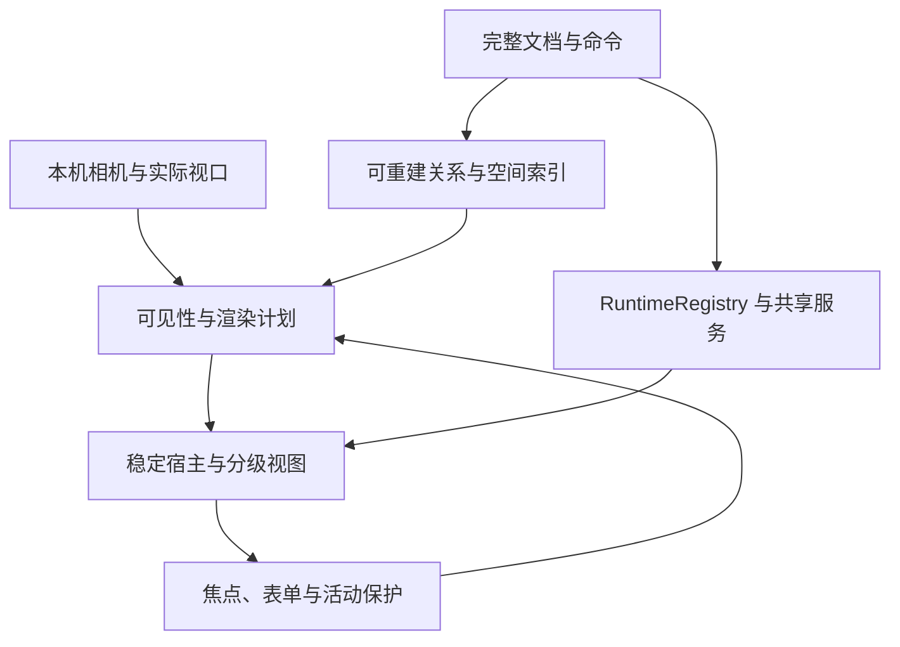

# Nav 无限画布 V3 完整实施方案

日期：2026-10-19，Asia/Shanghai。  
状态：完整实施设计；尚未开始 V3 代码开发、创建分支、合并、部署或修改生产数据。  
输入：用户提供的《Nav 无限画布 V3 开发上下文》，以及本次核对的 V2 源码、文档、PR 和 CI。  
目标：在 V2 完整空间编辑语义之上，使运行开销按可见内容和必要任务分配，同时保护聊天、输入、插件和离线数据。

## 1. 接手基线与证据

### 1.1 本次核实结果

| 项目             | 当前事实                                                                                    |
| ---------------- | ------------------------------------------------------------------------------------------- |
| 仓库             | `wymix-tech/Nav`                                                                            |
| main             | `27e915f1f33692fa8c90b8736974255d0b73eff9`，尚不含 V1/V2                                    |
| V1               | 分支 `feat/infinite-canvas-v1`，PR #2 open、draft                                           |
| V2               | 分支 `feat/infinite-canvas-v2`，PR #3 open、draft，base 为 V1                               |
| V2 HEAD          | `899b4561b6faec0f4d8b0c5a2871a800ae1b29d2`                                                  |
| 附件固定源码验证 | `32027e944cceaec94d167fbbe5bbd43372867d24`，CI run `39183401596` success                    |
| 本次新增核实     | HEAD 的 CI run `39183970021` 也已 success；check、开发回归、生产回归、Docker 构建均实际成功 |
| 未验证项         | 真机、参考 PC 性能、生产部署副本迁移/回滚及 V2 全部验收矩阵                                 |

附件记录的有效源码测试为 92 项通过；开发 Chromium/Firefox/WebKit 70 通过、5 跳过；生产 Chromium 25 通过；Docker 构建通过。HEAD 与该源码验证提交仅有文档差异，最新 HEAD CI 又确认全部适用步骤成功。本次未重新执行项目测试，不把历史数字当成本次本地运行结果。

5 个跳过分别是 3 个仅生产运行的离线壳场景、2 个非 Chromium 的 CDP 触屏场景。三浏览器开发通过不等于三浏览器生产通过，WebKit 也不等于真实 Safari。

V1/V2 功能已完成；发布验收仍有未闭环项。V3 应基于包含 V2 的代码，建议分支 `feat/infinite-canvas-v3`。实施前再查远端：未合并时从最新 V2 切依赖分支，以 V2 为 PR base；已合并时核对 main 包含关系后从 main 开发。不能从当前旧 main 假定已存在 V2。

### 1.2 本期起点

已有能力：世界坐标、独立相机、原子命令、单层组、独立区域、层序和布局锁、搜索定位、本机命名视角、当前协议的离线保存和恢复。当前所有组件仍挂载；memo 不等于裁剪，也不停止内部定时器。

已知性能样本只是 V1 共享 Linux/SwiftShader 下 100 时钟的 31.9/37.1/58.6ms p95，采样帧数不足正式要求。V2 尚无参考设备 p95，不能先归因或宣称 V3 必然达到某个加速比例。

## 2. 产品目标与范围决策

### 2.1 V3 首版必交

1. 可重复的 V2/V3 性能基线与生命周期观测。
2. 按“空间身份＋组件实例”拥有状态和任务的运行管理层。
3. 内置组件的状态/服务迁移、共享调度、请求去重和权限清理。
4. 有保护条件、迟滞和失败回退的可见性管理。
5. 对明确可恢复的内置视图执行延迟挂载和视口裁剪；旧插件保守保活。
6. full、summary、outline 分级展示，以及屏幕外目标的可靠定位和恢复。
7. 可重建空间索引，服务渲染、框选和吸附候选；索引不改变文档语义。
8. 保留全部 V2 数据、命令、锁、通知/历史、恢复和插件安全约束。

首版保持每文档 100 个组件上限；组/区域各 50、配置 16KiB、API 2MiB、结构 50,000 节点、历史 50 条等限制不因产品 V3 自动改变。

### 2.2 对原 V3 路线的拆分

| 工作                            | 本方案位置           | 交付要求                                             |
| ------------------------------- | -------------------- | ---------------------------------------------------- |
| 运行状态、可见性、LOD、派生索引 | V3 首版主线          | 必交，使用当前合法 100 组件场景证明正确性与收益      |
| 300/1000 等规模研究             | 第 16 节扩展闸门     | 提交预算与测量结论；不默认成为生产支持数量           |
| 增量同步                        | 第 16 节独立扩展设计 | 不与首版裁剪强耦合，启用需单独协议和恢复验收         |
| 空间分块加载                    | 第 16 节独立扩展设计 | 部分数据不能伪装完整 Dashboard，需独立后端和离线模型 |
| 插件可回收生命周期协议          | 第 9 节扩展契约      | 首版维持旧协议；不以插件声明替代无损证据             |

这么拆分的依据是现有瓶颈同时涉及视图、任务和完整快照；裁剪只能解决其中一部分。先建立可靠的资源管理，再评估完整数据链的规模，不把增加数量上限当作无限画布已完成。

不引入新画布引擎、CRDT、多人协作、嵌套组、连线或新共享视角。本期不会承诺任意 iframe 的私有状态可以序列化恢复。

## 3. 版本与兼容决策

| 层次                                        | V3 首版                                      |
| ------------------------------------------- | -------------------------------------------- |
| Dashboard.documentVersion                   | 保持 3                                       |
| 请求 schemaVersion／X-Nav-State-Schema      | 保持 3／精确字符串 `3`                       |
| canvasScene.version／canvasSettings.version | 保持 1／1                                    |
| 网格 layoutVersion                          | 保持 2                                       |
| CanvasViewPreference.version                | 保持 1                                       |
| Dexie schema／NamedView.version             | 保持 4／1，不新增运行状态表                  |
| 插件 manifestVersion                        | 保持 2，不增加强制生命周期要求               |
| 新本机聊天记录格式                          | 独立 sessionStorage 格式版本 1，不是文档协议 |

首版主要改变运行内存、视图和派生缓存，不修改共享数据语义，无需无意义的数据库迁移或整体协议 4。已有旧文档仍走 V2 的显式迁移，未来未知版本仍停写保留。

如果后续扩大数量、增加共享持久字段、插件必选能力或分块文档语义，必须单独审查旧客户端行为，再决定版本。新增可选传输能力也要独立协商，不把所有版本号统一替换。

## 4. 架构与状态分层

### 4.1 四个正交维度

| 维度         | 回答的问题                             | 权威来源                         |
| ------------ | -------------------------------------- | -------------------------------- |
| 文档存在     | 组件/组/区域是否存在、配置与几何是什么 | 完整 Dashboard 与原子命令        |
| Runtime 存活 | 谁拥有草稿、数据、流、控制器和订阅     | RuntimeRegistry 和共享服务       |
| View 挂载    | 当前是否创建昂贵 Vue/DOM/iframe 视图   | 生命周期策略和渲染计划           |
| 显示级别     | full、summary、outline 或屏幕外        | 相机、像素尺寸、可见性和活动保护 |

文档存在不等于必须创建完整视图；视图不存在也不等于任务应取消。四者不能用一个 `visible` 布尔值代表。

### 4.2 运行路径



共享 Store 不订阅运行状态逐帧变化；Runtime 不写 widget.config 保存草稿；可见性计划不调用文档 commit。搜索、图层、组边界、锁、fit/minimap 和导出继续来自完整文档或完整派生结构。

### 4.3 初期保留轻宿主

100 组件规模下，先保留每个组件的稳定外层 WidgetHost，卸载的是被认证可重建的昂贵内容视图。宿主保持稳定 ID、父级、几何与 z-index；summary/outline 在其宿主内显示，避免 DOM 搬家。

因此首版并不声称所有 DOM 数量都只与可见组件数相关：轻宿主仍为 O(文档组件数)，昂贵详情视图约为 O(可见＋必要保活)。指标必须区分宿主、详情视图、iframe、Runtime 和网络任务数量。

## 5. Runtime 身份、接口和所有权

### 5.1 身份

`RuntimeKey = (spaceKey, widgetInstanceId)`。spaceKey 复用现有 viewSpaceKey，包含确认的服务器 instanceId＋dashboardId，或 standalone 持久 UUID。widgetInstanceId 是 widget.id，不是 widgetId 类型名。

单独维护 typeIdentity：builtin/installed 的 source、widgetId，以及安装插件的不可变提交/入口身份。相同 widgetId 的内置与安装类型不得串用适配器、名称、状态或缓存。相同 key 的类型真实改变时，以新 runtime generation 替换；仅配置变化不得误判成类型替换。

服务身份未确认时不读取其他空间的私有运行记录，也不写含混的持久 key。可以保留临时内存状态，确认身份后经任务序号校核再绑定，禁止迟到初始化写入已切换空间。

### 5.2 类型草案

```ts
interface RuntimeIdentity {
  spaceKey: string
  widgetInstanceId: string
  typeIdentity: string
}

type RetentionPolicy = 'reconstructible' | 'stateful-recoverable' | 'opaque-retain'

interface RuntimeHandle<State, Summary> {
  identity: RuntimeIdentity
  generation: number
  policy: RetentionPolicy
  getState(): Readonly<State>
  getSummary(): Summary
  attachView(): () => void
  updateConfig(config: Readonly<Record<string, unknown>>): void
  setDemand(demand: RuntimeDemand): void
  // 真实删除/退出/空间结束，不用于普通移出视口
  dispose(reason: DisposeReason): void
}
```

完整实现应使用判别类型区分各适配器，不以 any 状态袋承载一切。summary 必须经过每类型白名单投影；控制器、MessagePort、API Key 不可返回为可导出的摘要。

Registry 只创建唯一 owner。View attach/detach 管理订阅，不创建另一个流或轮询器。Runtime 命令与源异步结果使用 generation、requestId 和 session/auth epoch 校验，已作废结果不能写入新对象。

### 5.3 状态持久性

| 数据                                     | 默认归属                               |
| ---------------------------------------- | -------------------------------------- |
| 几何、配置、名称、组/区域/层序/锁        | 原共享文档                             |
| 输入草稿、未完成流、请求控制器、采样状态 | 本机 Runtime 内存                      |
| 已有聊天历史、可恢复输入和已收片段       | 受限的同标签页 sessionStorage 私有记录 |
| 临时 API Key／认证凭据                   | 内存；使用现有认证入口，退出立即清理   |
| 天气/监控公共缓存与授权缓存              | 各共享服务，按来源和 auth scope 隔离   |
| 索引、LOD、可见性和挂载计划              | 可随时丢弃重建的派生内存               |

不把这些运行数据写入 Dashboard、同步队列、文档历史、搜索或通用 backups。也不为内存状态引入新的 IndexedDB 数据库版本。

## 6. 生命周期表与资源释放

### 6.1 事件语义

| 事件                | Runtime／任务                                         | View／插件                            | 数据与请求规则                                 |
| ------------------- | ----------------------------------------------------- | ------------------------------------- | ---------------------------------------------- |
| 普通离开视口        | 保留状态；按 demand 暂停可暂停采样，聊天继续          | 可恢复内容延迟卸载；不透明插件保留    | 不发新聊天，不因 detach abort                  |
| 低倍率摘要          | 用白名单摘要，降低展示成本                            | 活动保护优先，插件仍保留              | 不变更共享配置                                 |
| 返回视口／搜索定位  | 恢复或创建必要 owner                                  | 按优先级挂载，先显示占位/摘要         | 复用缓存；一次至多一个同 key 请求              |
| document.hidden     | 沿用服务的后台策略；流受已有超时约束继续              | 不以隐藏标签页为理由强制销毁          | 不补做错过的轮询，不伪造速度                   |
| 配置变化            | 只更新受影响的数据源；作废旧响应                      | 已挂载视图更新配置，插件走原通道      | 活动聊天使用发送时配置快照；新配置用于后续发送 |
| 真实删除／清空      | 立即使 generation 失效、终止任务与订阅                | 真正卸载，插件 dispose/关闭通道       | 删除须先通过原子命令与锁校验                   |
| 撤销删除            | 恢复文档；有合法保留状态则复用，否则创建停止态        | 插件可重建，但不保证私有 DOM 状态     | 不重发旧聊天／恢复旧副作用                     |
| 登出／401／权限失效 | 终止授权任务，清除临时 Key 和受限缓存                 | 保留公共浏览能力，关闭授权表单        | 迟到授权响应不得进入公共缓存                   |
| 明确切换空间        | 默认结束原空间活动请求、保存非敏感草稿/片段并标记中断 | 释放旧空间视图/通道；不跨空间偷偷保活 | 不自动继续请求；旧空间状态有明确配额           |
| 页面关闭／刷新      | 尽力 checkpoint 私有可恢复内容                        | 浏览器会销毁运行环境                  | 重开视为中断，不能自动恢复网络流               |

AbortController 只表示停止本客户端接收/请求，不承诺服务端或模型供应商的任务和计费一定同步取消。因此自动恢复不能通过重发请求实现。

### 6.2 删除、撤销与失败

Runtime 清理在本机文档替换已接受后执行，不在命令验证前执行：越权或锁拒绝的删除不能先把聊天停掉。若随后持久化失败，沿用现有未保存状态；用户可以撤销文档，但已终止的网络任务不会自动复活。

删除的可恢复内置状态可以放入本机 tombstone：最长 5 分钟、最多 20 个，受总内存软预算约束。优先丢弃已 checkpoint 的干净记录。撤销只保证文档恢复；无有效私有状态时明确显示“组件已恢复，运行任务已结束”，不假装连续流。旧插件删除后无法保证恢复其私有输入，与正常插件卸载边界一致。

真正类型替换、服务实例替换和跨空间不能仅凭相同 widget.id 复用 tombstone。异步流回调在删除后即使迟到，也必须因 generation 不符被丢弃。

### 6.3 内存预算

首版建议每活动空间可恢复状态软预算 32MiB，最多保留一个非活动空间的干净内置缓存，最长 60 秒。它是启动调参值，须测量后记录，不是浏览器堆内存的硬保证。

活跃流、未保存草稿、正在编辑的表单和不透明插件不能为达预算被强制回收。超过软预算时先取消预加载、回收干净缓存和过期 tombstone、停止非必要详情升级，并展示诊断状态；不能静默丢输入或取消已有用户任务。必要时拒绝继续启动新的昂贵任务并说明原因，现有任务遵守原服务并发/长度/超时限制。

字节估算针对可序列化文本做增量统计，不把 API Key stringify 进测量，也不每帧扫描所有聊天。缺少通用浏览器堆指标时记录 owner/订阅/缓存计数与估算字节，不捏造精确总内存。

## 7. 活动保护与保活判定

### 7.1 保护条件

| 条件                           | 必须保护的对象                                                          |
| ------------------------------ | ----------------------------------------------------------------------- |
| 输入焦点／输入法 composition   | 当前内容 View 和 Runtime                                                |
| 配置弹窗、未提交配置表单       | 对应 WidgetWrapper／表单 View 和草稿                                    |
| 活动 pointer capture／几何手势 | 接收事件的宿主和必要控制层；屏幕外组成员由模型完整参与                  |
| 正在生成聊天                   | Runtime 和请求必保活；首版同时保留其 View，隐藏时停止昂贵 Markdown 刷新 |
| 不透明插件已启动               | 其原 iframe、父级和 MessagePort                                         |
| 显式进入组件／搜索后待聚焦     | 临时 full 提升租约，完成可访问性焦点交接                                |

单纯 selected 不强制把整组所有屏幕外详情都挂载。选择和整组移动依赖完整模型；否则一次全选就会绕过全部预算。选择边框、宿主和指针目标依然必须存在。

### 7.2 实现方法

根层集中监听 focusin/out、compositionstart/end、pointer 生命周期；Wrapper/内置配置面板显式报告 open/dirty。pin 使用 reason＋持有者 token 的引用计数，返回 release，所有退出/异常路径释放，不能留下永久保活标记。

对 iframe 只判断父页面 activeElement 是否为该 iframe，不读取内部 DOM。旧插件本身已属于 opaque-retain，宿主不能猜测内部表单是否干净。焦点转移先等待一个稳定事件周期再降级，避免 activeElement 暂时落到 body 时误回收。

pin 的释放只表示可重新评估，不立刻卸载；仍经过退出迟滞。空间切换、真实删除和权限撤销优先于普通 pin；其处理遵守第 6 节明确语义。

## 8. 内置组件迁移与共享调度

### 8.1 ChatRuntime

迁移 input、messages、loading/error、请求 ID、AbortController、180 秒超时与临时请求配置到 ChatRuntime。ChatWidget 负责呈现、输入和发送/停止动作；组件卸载只 detach，真正 dispose 才 abort。当前未迁移的 ChatWidget 卸载会 abort，因此认证完成前保持其 View，不启用裁剪。

发送流程必须显式由用户动作触发，owner 内检查同实例 loading 和原认证/长度限制。一次发送生成 requestId，绑定当时的模型/端点/消息上下文；流回调校验 runtime generation＋requestId。每个实例只有一个活动请求；新会话/停止/删除/登出按明确原因终止。

保留原 16,384 字符输入、单回复 1MiB 和会话最多 64 条等约束；数据超限报错，不为扩大运行规模放宽。原消息已存在但总体超出本机缓存预算时保留源记录，不自动截断成“迁移成功”。

models/defaults 等聊天元数据也按来源和授权 epoch 复用，避免每次 View attach 再拉两次；这类缓存不携带临时 Key，不改变服务端允许模型/端点校验。ChatRuntime 的配置草稿与已接受配置分开，打开/取消表单不能暗中修改后续请求或公开配置。

原始文本在 Runtime 持续接收；有可见 View 时按最多一帧一次或约 50ms 合并通知。隐藏保活 View 不每 token 重新 marked/DOMPurify；回来时对完整最新文本统一净化并恢复滚动锚点。不能拼接未经净化 HTML 优化性能。用户离开底部后保留阅读位置，不每次 attach 强制滚到底。

#### 私有记录与旧 key

新 key 使用编码后的 `(spaceKey, widget.id)`，记录格式 version=1，保存非敏感 input、messages、可读错误/中断状态和滚动锚点；不保存 API Key、AbortController、认证头、模型响应函数。约 250ms 合并 checkpoint，并在流结束、停止和 hidden/pagehide 时尽力刷新。存储失败保留内存并明确提示，不能宣称已保存。

旧 `nav_chat_<widget.id>` 缺少空间身份，无法普遍证明属于当前空间。检测到时保留原记录，并提供“旧会话记录”预览和显式绑定当前组件的入口；绑定成功写新 key 与绑定标记，不静默跨空间导入或删除旧记录。同一旧记录在本标签页只能绑定一个空间；已绑定记录不能在其他空间再次自动读取。

刷新时保存的 streaming 状态转换为 interrupted：显示已收片段，loading=false，不重发。此改动不保证杀进程前最后一个片段落盘，也不把 runtime checkpoint 称为服务端断点续传。

### 8.2 时钟与轻量输入

- ClockWidget 改为共享 clockService：有需求时一个秒级调度器，Date/格式化缓存按必要格式复用；无订阅或 hidden 时停止无用视图更新，返回取真实当前时间，不补秒。
- full 需要秒，summary 最多分钟刷新，outline 不订阅时间。订阅由 Runtime demand 决定，卸载清理可重复调用。
- SearchWidget 的输入值和 BookmarkWidget 的未完成编辑状态先分类迁移；无法可靠恢复的表单保持 View。composition、焦点和配置弹窗开启期间不裁剪。
- 这些组件只有在适配器测试通过后标为 reconstructible/stateful-recoverable，不能因看上去简单就视为无状态。

### 8.3 Monitor、Weather、Docker

| 服务    | 复用与改造                                                                                  | 暂停/恢复规则                                                                     |
| ------- | ------------------------------------------------------------------------------------------- | --------------------------------------------------------------------------------- |
| Monitor | 复用按磁盘 key 的 subscribeMonitor/cache，不再增加第二套采样器；补 demand、授权域和请求序号 | 无前台需求暂停；hidden 沿用现有规则；返回复用缓存后按到期时间刷新                 |
| Weather | 保留 10 分钟缓存和超时；新增同城市 in-flight 去重、订阅引用计数与迟到响应保护               | 无需求暂停 60s 检查；已有合法请求可完成缓存；仅所有消费者释放时才考虑取消共享请求 |
| Docker  | 将每实例轮询收敛到按端点/授权会话的 dockerService；消费者只选择容器和 5～60s 需求           | 活跃消费者决定最快采样周期，各自按需通知；无需求暂停，不重放错过的轮询            |

公共缓存和认证数据不能混用；缓存 key 不含原始 token，使用 auth/session epoch 区分。登出清除受限数据并取消授权请求，迟到响应不得回填。天气城市变化使用 key/requestId 校验，旧城市回包不能覆盖新配置。

天气原始数据缓存与显示投影分开；单位和城市以已接受的 config 快照为准，配置表单中的未提交单位不能改变当前请求的响应映射。换单位可以复用原始缓存，不为纯展示变化额外拉取同城市数据。

Docker 速率以容器稳定 ID、同一授权域、有效的单调时间和计数基线计算；暂停、容器重启、计数回退或数据源改变后先建立新基线，首个速度显示“—”，不将暂停期间平均值或补偿值当瞬时速度。多个相同快照不得重复推进基线。

服务调度只合并真正相同的数据源；不同磁盘集合、来源、实例或权限仍分开。可增加 0～250ms 的恢复抖动和并发上限，避免一次视角跳转导致请求风暴；高优先级用户刷新仍走去重和原服务限流。

## 9. 旧插件保活与新生命周期边界

### 9.1 首版必须兼容的旧插件

manifest 2 只有 mount、可选 updateConfig 和清理函数，没有可验证的暂停/恢复/快照能力。首版采用 opaque-retain：

- 保留现有插件首次启动行为，不因优化悄悄取消屏幕外插件的自动启动。
- 启动后移出视口或变为摘要时，原 iframe、父级、srcdoc、secret 和 MessagePort 不变，不切 v-if、不 Teleport、不重设 src、不放入另一个 DOM 容器。
- 低倍率可在宿主上显示安全摘要，并在失去焦点保护后隐藏完整内容的绘制/交互。所用 CSS 必须经三浏览器验证；不能把 CSS 隐藏描述成 JS 暂停或零资源消耗。
- 回到 full 恢复同一 iframe；保留宿主初始化超时、错误显示和显式重试。优化失败不能自动“刷新插件”掩盖状态丢失。
- 目录刷新但不可变插件身份未变时，不重启 runner；真实安装身份变更才作类型替换处理。
- CSP、allow-scripts、无 allow-same-origin、消息来源/secret/端口校验、配置速率/大小/认证检查全部保留。

若整盘都是旧插件，保活成本仍可能接近 V2；这是明确的兼容边界，不能为了达到挂载预算强制销毁它们。

### 9.2 后续可选 lifecycle/1 契约

首版不把此契约作为插件必选要求。要真正回收新插件，另行实现和验收下列契约后才允许标记为可恢复：

| 能力                        | 必须明确的语义                                                       |
| --------------------------- | -------------------------------------------------------------------- |
| capabilities 协商           | 固定来源清单声明＋私有通道运行时确认；未知版本退回 opaque            |
| setVisibility               | 通知展示状态，不授权网络或父页面访问；不能以成功响应推断可序列化     |
| suspend/resume              | 带 requestId/epoch，确认定时器/订阅状态；不把“暂停”当卸载承诺        |
| serializeState/restoreState | 版本化普通 JSON，建议≤256KiB、深度≤16，拒绝保留键；只进独立本机内存  |
| 副作用约定                  | 重建 mount/restore 不重发交易、任务和用户操作；需要插件有证据证明    |
| 超时/失败                   | 先保留旧 iframe；无法可靠恢复则退回 opaque，显示问题，不自动销毁重试 |

候选默认超时 500ms；快照通过后也要在原 iframe 尚可回退的条件下验证恢复流程。插件自报 supportsSuspend 不等于经过认证的安全回收策略。快照也不能夹带主页面认证、写共享配置或进入通用文档备份。

是否新增 manifest 可选字段或独立消息协议版本，在实现此扩展时单独决定；当前 manifest 2 和文档 3 不因设计了候选消息就自动升级。

## 10. 可见性与 LOD 规则

### 10.1 可见性来源

以 V1 相机公式计算实际视口世界矩形，通过索引查询组件；不靠逐项 getBoundingClientRect 或 IntersectionObserver 作为唯一真相。观察器可用于测量/诊断，不能遗漏被缩放、尚未挂载或处于草稿位置的对象。

初始建议：进入预取范围为视口外扩 160 CSS px，保留范围为外扩 320 CSS px；换算世界距离时除 zoom。对象在保留范围外连续 1,500ms、无保护且适配器已认证可恢复，才卸载昂贵 View。返回进入范围立即取消回收计时。

迟滞与首次挂载分开：初次只为 full 候选/显式激活创建昂贵可恢复 View；summary/outline 先使用文档摘要。opaque 插件沿用原首次启动，不按新预取策略延迟。快速相机移动取消已过期的未开始挂载任务，不能先为旧位置创建一批视图。

### 10.2 显示级别

设组件投影宽高为 w×zoom、h×zoom，建议基础阈值如下：

| 级别      | 默认条件                         | 显示和任务                                   |
| --------- | -------------------------------- | -------------------------------------------- |
| full      | zoom≥0.4 且投影宽≥160px、高≥80px | 正常交互；有需求的数据刷新                   |
| summary   | zoom≥0.12 且宽≥48px、高≥24px     | 图标、名称和类型白名单摘要；降低通知频率     |
| outline   | 其余可见对象                     | 轮廓/状态标记；不显示复杂业务 DOM            |
| offscreen | 不在保留范围且无可见需求         | 可恢复 View 可卸载；Runtime 和插件按策略保留 |

阈值是实施起点，不是已验证的最优值。采用约±10% 升降级迟滞：升级阈值乘 1.1，降级阈值乘 0.9；持续约 120ms 后改变普通级别，显式用户激活和保护条件立即优先。所有条件在纯函数中统一，避免缩放临界点反复重挂。

首次计划没有旧级别时直接按基础阈值分类。active View 可保持 full-mount 但暂不绘制全部细节；“是否挂载”和“显示什么”必须分开记录，不能把 retained-full 当 offscreen-unmounted。

### 10.3 不同类型摘要

- Clock：当前时分或仅类型名，不做每秒大 DOM 更新。
- Weather：缓存的城市/温度和数据时间；没有缓存则显示待加载。
- Monitor/Docker：经授权的已有缓存摘要；退出登录后清除受限值。
- Chat：消息数量、正在生成/中断/错误状态，默认不把消息文本铺到概览或全局索引。
- Search/Bookmark：名称和已验证公共配置的计数，不显示未保存私有输入。
- 插件：manifest 显示名、图标和 ready/error；不读取 iframe DOM 生成截图或摘要。

summary/outline 保留选择、组归一化、宿主高亮和可访问名称。点击“进入组件”时先对目标局部 fit 或提高本机 zoom、申请 full 租约、等视图准备再交接焦点；不改变文档。

### 10.4 列表、网格和区域

空间/列表仍使用同一宿主父级。列表先用稳定占位高度和滚动容器范围计算可见项，沿用 y/x/id 的 CSS order；不要通过重排 widgets 数组实现虚拟列表。配置/焦点/旧插件保护同样适用。

网格首版保持现有全量 View 策略，复用已迁移 Runtime 和服务；空间裁剪的收益与网格分开报告。显式共享 grid/canvas 模式切换可能沿用现有渲染器 teardown，不能把它承诺成任意插件无损恢复。V3 不把模式切换当普通视口裁剪；内置 Runtime 按同空间保留，插件私有状态的限制在操作说明中明确。

区域不是 Runtime：按完整模型参与 fit/minimap/搜索，视图可仅绘制视口交集和必要边框/标题；巨大区域不创建巨大纹理或整张离屏位图，不改变真实区域几何，也不因此变成组件容器。

## 11. 渲染调度和预算

### 11.1 一个计划、少量变更

统一 render planner 的输入为相机、实际容器、几何 epoch、活动保护和类型能力。每个 RAF 最多计算一次目标计划，只对级别/挂载/demand 真正变化的 ID 发布状态；不能因 camera 对象变化给全部子组件传入新计划对象。

优先级：活动焦点/表单/指针 → 显式定位待激活 → 当前视口 full → 当前视口 summary → overscan 预取 → 干净缓存。背景加载允许取消，已有请求不因排队优先级调整重发。

建议挂载启动预算每帧 4ms，最多 2 个轻 View 或 1 个重 View，等待显式激活的目标可优先。该预算只能控制启动，不能抢占一个长耗时插件 mount；记录超预算任务，必要时保持摘要并按需激活，不声称能硬保证每帧 4ms。

### 11.2 软预算与过载

建议目标 full View 40 个，干净 warm View 20 个；保护项允许超出，不把超过数量当丢状态的理由。合法的可见 full 对象超预算时优先回收视口外 warm 和停止预取；不能仅凭排名把用户正在操作的详情替换成摘要。仍超预算则保持正确性并标记 over-budget，以测量决定后续策略。

同理，用户全选不强制 100 个详情，100 个 opaque 插件则可能全部保留；两种情况在指标中分别报告。首次导航等待时始终有几何正确的占位/摘要，用户不会点击到无反馈空白。

### 11.3 可回退模式

提供一个统一会话级资源模式：observe（仅统计，维持全量视图）、safe（按认证策略优化）、full（关闭回收/LOD，仍复用 Runtime owner）。可由构建默认和本机会话选择控制，不写 Dashboard 或旧 viewPreferences 格式。

observe/full 不应用视口驱动的降级和采样暂停，已挂载 View 保持 full demand，但继续遵守原 hidden/编辑/认证规则和已迁移的共享去重。两者与原始 V2 各测一组，用来区分 Runtime/服务合并收益和真正裁剪收益，不能把 observe 当成未经改动的 V2。

回退到 full 不能销毁 Registry 后再创建一遍；它只改变视图计划，保持活动流和插件。单一适配器状态迁移异常时，将其降为 retained，其他对象继续优化。索引异常回退精确遍历；不能回退到丢失世界坐标或放松锁的路径。

## 12. 可重建空间索引

### 12.1 索引接口和实现

采用统一 RectIndex 接口：build、queryIntersect、getBounds、epoch；首版保留精确线性参考实现，生产候选为按最长轴中位数划分的只读 AABB/BVH，n<32 可直接线性查询。完整实现保持小而可测，不默认引入大型画布库或新运行时依赖。

BVH 在几何发生变化的文档边界重建，当前 100 规模可同步完成；不在每帧重新构建。是否默认开启树实现由查询/更新测量决定：接口和一致性必交，100 规模若线性更快可以使用线性后端，并如实说明。研究样本使用同一接口比较，不以引入树本身作为性能结论。

### 12.2 三类派生结构

| 结构           | 条目                       | 用途                                  |
| -------------- | -------------------------- | ------------------------------------- |
| renderIndex    | 所有真实 widget 的世界矩形 | 可见性和预取，不按组裁掉成员          |
| selectionIndex | 自由组件＋组联合范围       | 与 V2 同义的框选和吸附候选            |
| regionIndex    | 独立区域矩形               | 区域绘制/定位候选，框选仍不自动选区域 |

组关系、成员 Map、rank 和完整内容 bounds 一起派生缓存，但不与空间树混成一份权威数据。矩形统一调用当前 canvasForWidget/fallback，不复制 120/90 后备公式。

巨大区域在 AABB 结构中只占一条，不能按每个网格单元复制数百万条。最小倍率下全部对象相交、巨型组覆盖视口时，查询仍可能 O(n)；此时依靠 LOD 减轻绘制，不能承诺树总是 O(log n)。

### 12.3 更新与失效

- 使用本机 geometryEpoch，不把服务端 revision 当唯一索引版本；本机连续编辑可发生在相同远端 revision 下。
- 新增/删除/移动/resize 改矩形；组成员变化改 selectionIndex；区域几何改 regionIndex；层序只改 rank；名称/颜色/config 和 ack 不无故重建几何树。
- 每次 Store 接受的新文档、撤销/重做、恢复、外部真正内容更新，按完整几何投影对比并原子替换索引快照。
- 相机、搜索词、运行摘要、状态通知不增加 geometryEpoch。沿用 V2 的内容/状态通知分类，不为重建缓存调用会推进 observedGeneration 的 cached()。
- 同空间任务序号和 geometryEpoch 共同保护异步初始化；未来如果放 Worker，结果过期即丢弃，期间使用完整线性结果，不用旧树当最新事实。

### 12.4 草稿与精确语义

编辑预览不每帧改索引。查询底层已提交快照时先排除活动目标，再叠加内存 draft 的精确矩形；组边界从完整成员和 draft 联合计算。绘制、框选、辅助线都使用相同草稿层。

索引只返回候选，最终应用 V2 的正面积相交、组归一化、锁和距离规则。6/10px 吸附、64px 扩展、24 个近邻上限不因树查询顺序改变；结果需稳定排序。搜索、fit、minimap、批量命令、删除和锁检查永远不是“只处理当前挂载对象”。

## 13. 导航、编辑与运行宿主的接合

### 13.1 可靠定位

为 useCanvasWorkspace 增加 `ensureTargetVisible/ready` 接口：先重新核对完整模型 ID/边界 → 设置本机 camera/presentation 或列表 scroll → 强制目标宿主可见/申请 full 租约 → 等实际 nextTick 与 View ready → 高亮和焦点交接。

每个步骤检查原导航 serial、spaceKey 和目标 generation；空间已切换、目标删除或用户发起新导航时旧任务立即失效。不能让迟到挂载把另一个空间滚回旧位置。

返回定位前状态继续包含 camera、presentation 和 scroll；先恢复布局/占位再恢复滚动，允许目标尚未挂载时定位到正确位置。命名视角跳转只改变相机，不启动所有离屏 Runtime 的网络请求。

### 13.2 与选择和手势配合

活动指针的宿主保活；视口外组成员的矩形和锁仍在完整模型中参与整组 delta。组成员移入/移出视口只改变视图计划，不能改变命令目标集合。选择覆盖层、辅助线和区域拖动继续由原统一控制器拥有。

Runtime 或索引更新不能扩大手势失效指纹：区域改名/改色保留拖动，无关配置或增删不撤回导航；几何、锁或成员真实变化才按 V2 规则取消整批。普通 View detach 不等于文档删除，也不能触发同类取消。

### 13.3 焦点和可访问性

摘要和轮廓使用宿主可聚焦按钮/名称，提供“进入组件”；不把不存在的 View 当焦点目标。挂载失败可重试或切 full 模式，但不重新发送聊天。保护释放与还原焦点均不在 iframe 内注入脚本。

隐藏 retained 内容时，在确认没有焦点/表单 pin 后才调整 aria-hidden/inert 和指针命中；浏览器兼容测试不通过时保留正常宿主裁切，牺牲部分性能。不能让用户 Tab 进入不可见但仍挂载的离屏内容。

## 14. 与文档、历史、存储和恢复的边界

不改变 V2 的 Dashboard 权威、整盘原子命令、50 条快照历史、If-Match、不可变 operationId、lease、generation 和未来版本停写。Registry 只观察已接受的文档变化，不参与文档保存的成功判定。

保留六项审查修复：通知区分 document/status；ack 不清历史；历史/文档同步变更；regions.order 恢复差异；导航返回/序号；source 身份和最小几何指纹。性能改造不能因“刷新数据”推进旧编辑页的 generation。

异步 Registry reconcile 用本机文档身份和自己的 serial，不能复用存储 observedGeneration 作为可任意更新的缓存字段。加载中临时 null 不当作真实清空；明确新空间接受后才结束旧空间。文档加载失败保留可恢复状态，不以空盘重建 Runtime。

运行状态不进入文档 canonical 比较；相机/LOD/摘要变化不制造 history、pending 或恢复差异。文档恢复成功后，对完整成员/类型/配置做一次 Registry reconcile 和索引重建；同 key 同类型保留安全私有状态，已删除/替换的 owner 按明确生命周期释放。

首版不优化成命令网络同步，也不贸然用可变结构共享替代不可变历史。可以清理同一路径重复但确实冗余的校验/clone，前提是确定唯一可信边界并有反向回归；服务端校验、锁转换和恢复新鲜度不能被“性能优化”移除。

## 15. 可观测性与正式性能基线

### 15.1 指标

| 类别    | 至少记录                                                             |
| ------- | -------------------------------------------------------------------- |
| 交互    | RAF p50/p95/p99、长任务、主线程工作耗时，输入序列和 zoom             |
| 渲染    | 轻宿主/full View/summary/outline/iframe 数，mount/unmount 和计划抖动 |
| Runtime | owner 数、重复 owner 检测、保护原因、软预算、tombstone/缓存计数      |
| 网络    | 每服务 key 的订阅/请求/取消/并发/命中缓存、聊天发送次数和片段连续性  |
| 索引    | 构建/查询耗时、候选数、精确比对结果、epoch 与过期结果丢弃            |
| 文档    | 命令 clone/校验/canonical/本地写入/发送字节耗时，与每帧成本分开      |

诊断默认仅在本机开发/测试使用；不记录消息文本、输入、Key、认证头或插件快照。支持输出不含私有内容的性能结果文件。开发观测面板本身可关闭，不能每帧深拷贝/打印完整文档造成新瓶颈。

### 15.2 场景

1. 100 时钟：全部可见、少量可见、快速跨区、1%/100%/800%。
2. 合法混合集合：30 时钟＋20 书签＋10 搜索＋10 天气＋10 Monitor＋10 Docker＋5 Chat＋5 插件，共 100；网络用固定隔离桩。
3. 强保护集合：多个草稿/表单、至少一条持续聊天流、多个有内部输入的旧 iframe；验证正确性和明确过载。
4. 文档组织：组/区域数量合法，跨视口组、巨型区域、负坐标、选中整组和全选。
5. 真实业务样本：在用户环境脱敏或本地构造，不把生产凭据传入测试。

### 15.3 测量规则和目标

V2 固定基线、V3 observe、V3 safe/full 在同设备、浏览器、生产构建、CSS 视口、输入序列、后台负载和固定服务响应下对比。每场景至少三轮，每轮至少 300 个有效 RAF，预热单列；不能把长任务帧当异常值删除。缺少 PerformanceObserver 长任务/堆指标时标为不可用，不补造数据。

| 项目                                      | 首版目标/门槛                                                                            |
| ----------------------------------------- | ---------------------------------------------------------------------------------------- |
| 参考 PC 的常规 100 时钟、合法混合场景交互 | p95≤33ms；不能仅在缩减样本后宣布完成                                                     |
| 定位后反馈                                | 宿主/摘要在下一可用绘制周期出现，通常≤100ms；目标 ready p95≤300ms，不含外部插件/网络加载 |
| 可恢复 View 的边缘来回                    | 1.5s 迟滞内不反复卸载，取消过期挂载计划                                                  |
| 请求正确性                                | 一次用户发送一次聊天；同源共享采样不因挂载次数倍增                                       |
| 生命周期                                  | 活动状态零意外丢失，旧 iframe 不因视口/LOD 重建                                          |
| 长时间循环                                | 20 轮跨区/缩放/定位后，计数回落到预期活跃＋缓存＋保护项范围，无孤儿 owner/订阅/端口      |

内存测量以稳定趋势和可解释存活集合为主；不要求浏览器立即归还进程内存。采样时记录硬件、浏览器、系统缩放、GPU/软件渲染、构建 SHA 与服务桩版本。真实 Safari/触屏另验，不能用 Chromium 指标替代。

V2 在同设备已超目标时，先提交可归因对照，再做局部优化；性能门槛未满足就如实保留未完成状态。所有必须保活对象都超过预算时，保持正确性，报告边界，而不是强制销毁来让计数好看。

## 16. 规模、增量同步和空间分块的扩展方案

本节交付研究和启用条件，首版不默认实施到生产。它回答后续如何扩大，避免首版只提高 widgets 上限。

### 16.1 规模预算闸门

300/1000 仅作为研究档位。纯几何可在独立 Rect[] 基准中构造大集合；不能把超限 Dashboard 绕过校验放进正式 API，再称为已支持。要做端到端研究，使用隔离研究构建和统一预算 profile，绝不对生产放宽入口。

扩大前必须核对：组件/组/区域和成员总数、请求体/结构节点/配置体积、完整历史字节、IndexedDB 队列、备份和恢复预览、搜索实体上限、图层面板、组边界、服务端兼容行重写。每个档位给出可接受文档体积和任务数量，不只给组件数。

正式扩大写入能力时，即使字段形状不变，旧 V2 客户端仍按 100/50 校验，不能假定兼容。需要显式能力/最小写入版本保护，通常应独立升级到新的文档/写入协议并提供迁移矩阵；不得在 schema3 上静默改变全部预算。具体数字以研究报告批准为准。

### 16.2 增量命令同步草案

若测量证明完整快照成为瓶颈，新增独立、精确协商的传输能力，例如 command transport/1；它不等同于文档版本。保持一份完整权威 state_json，命令只是网络表达，不自动变为 CRDT。

命令信封至少含 operationId、baseRevision、instanceId、transportVersion、确定性命令和 payloadHash。ID、创建时间等在发送前确定，服务端不能为同 ID 重试生成不同结果。网络上传的是已确认的世界 delta/目标矩形等结果，不上传依赖当前 zoom 或当前吸附环境的指针事件。

服务端流程：能力/认证校验 → 操作 ID 去重/哈希一致 → If-Match/baseRevision → 在完整文档上执行同一共享命令/锁转换 → 验证全量结果 → 事务保存新文档、兼容镜像和回执。整组动作不能拆成多条部分提交。相同 ID 不同内容 409，过期 revision 412；新旧 transport 混用仍受同一 revision 序列约束。

离线队列保存不可变命令及足够本地重放/恢复信息；已有 snapshot pending 不原地改成 command。新格式必须独立识别、备份和隔离。只合并尚未发送且可证明语义等价的后继；rename→delete、lock→move 等不能盲目相加。过期操作去重记录、响应丢失和服务实例替换均有回归。

完整快照传输作为兼容/导出/恢复路径保留；新能力不可用时，只对当前文档格式确实兼容的客户端降回快照。不能把未知未来文档转换成旧格式再发送。

### 16.3 空间分块加载草案

当文档体积和首次加载成为瓶颈，再分离“完整轻量清单”和“按需内容块”。清单包含全局稳定 ID、类型、几何、组/区域/层序/锁和引用；业务配置/大内容按稳定实体分页存放。空间 tile 只作为查询派生索引，一个巨大区域/跨块组不复制为无数权威成员。

所有块带同一文档 revision/read token；旧 token 失效时明确重取，不能拼出混合版本文档。缺失配置是 not-loaded，不是空 config 或已删除。引入 `DocumentProjection` 与完整 `Dashboard` 的不同类型，Store 的整盘 commit/导出不能接受 projection。

搜索需要完整允许字段索引或有版本的服务端检索；组命令由服务端对完整成员原子执行，不只操作当前块。离线编辑仅在所需数据完整且有有效基线时开放，否则明确只读/待加载。导出和备份必须取得完整一致数据，不能导出可见块冒充全部。

分块将改变存储、离线和恢复语义，需独立协议、表结构、迁移、回滚和客户端矩阵，不能只把 GET 改成 bbox 参数。完成这条扩展后，才可以讨论超出整盘快照预算的生产规模。

## 17. 模块拆分与当前代码接入

以下是计划模块，不表示仓库当前已有这些文件；实施时结合实际职责合并小文件，不能为目录完整性创建无调用方骨架。

```text
packages/frontend/src/runtime/
  types.ts                     身份、策略、demand、生命周期与摘要类型
  runtimeRegistry.ts           唯一 owner、generation、回收和 tombstone
  useRuntimeReconciler.ts      已接受文档变化与权限/空间的编排
  activityGuard.ts             焦点/输入法/表单/指针保护 token
  chatRuntime.ts               聊天状态、流、checkpoint 与取消
  chatSessionStore.ts          私有 key、旧记录绑定与格式校验
  adapters/                    内置类型能力与摘要投影

packages/frontend/src/canvas/
  visibilityPolicy.ts          迟滞/LOD 的纯决策
  useCanvasRenderPlan.ts       相机/索引/保护的计划编排
  renderScheduler.ts           预算、挂载队列和过期计划取消
  spatialSceneService.ts       完整文档派生结构与 geometryEpoch

packages/frontend/src/components/canvas/
  CanvasWidgetHost.vue         原有稳定宿主提取与轻壳
  CanvasWidgetSummary.vue      白名单概览和进入组件入口
  CanvasResourceNotice.vue     可选资源状态/回退入口

packages/frontend/src/services/
  clockService.ts              共享秒/分钟调度
  dockerService.ts             共享 Docker 请求与基线
  monitorService.ts            扩展现有服务，不重复创建
  weatherService.ts            扩展现有缓存/去重

packages/shared/src/canvas/
  rectIndex.ts                 纯索引接口、线性参考与 AABB 实现
  spatialProjection.ts        文档矩形/选择单位的完整投影
```

### 17.1 具体入口

| 当前入口                           | 改动方式                                                                                |
| ---------------------------------- | --------------------------------------------------------------------------------------- |
| App.vue                            | 运行服务在两种布局之上持有；跟随确认的文档空间和权限，不自行初始化第二个 StorageAdapter |
| CanvasGrid.vue                     | 使用完整模型和派生索引组装轻宿主、render plan、summary；保留原工具和命令桥接            |
| DashboardGrid.vue                  | 接入 Runtime/共享服务，首版保持全量视图，网格行为单独回归                               |
| WidgetWrapper.vue                  | 报告配置弹窗/dirty/focus 活动；内容视图可 detach 时保持宿主和表单安全                   |
| WidgetRenderer.vue                 | 按 source＋类型身份选择 adapter，View 只 attach，不持有网络 owner                       |
| ChatWidget.vue                     | 移除组件内请求所有权和卸载 abort；UI 调用 ChatRuntime，保留净化/输入法语义              |
| Clock/Weather/Monitor/DockerWidget | 消费统一 demand/服务；删除被替代的 timer/controller，保证没有新旧两套 owner             |
| Search/BookmarkWidget              | 明确输入/表单状态和恢复能力，未认证前 retained                                          |
| SandboxWidget.vue                  | 按稳定插件身份启动；opaque 首版保留 iframe、source、通道和安全校验                      |
| pluginRuntime.ts                   | 首版不因裁剪变更隔离协议；可选新 lifecycle 放独立后续工作                               |
| useCanvasWorkspace.ts              | 导航加入 View ready 阶段，保留返回 scroll/presentation/serial 修复                      |
| useCanvasInteraction.ts            | 候选接索引＋draft，所有权/取消/指纹规则不变                                             |
| shared scene/geometry/alignment    | 复用权威关系、fallback、锁和精确几何；索引只作候选                                      |
| dashboardStore/storageEvents       | 只暴露已接受文档变化供协调，保留 R1/R2；运行通知不得进入文档/历史                       |
| SyncAdapter/LocalAdapter/server    | 首版协议不变，补回归，不能为优化删掉版本/锁/恢复校验                                    |

### 17.2 清理与复用要求

每迁移一种组件先明确新 owner，再移除原 owner，不在中间版本同时挂两套逻辑。onUnmounted 不能遗留 abort Runtime 的副作用；View 与 Runtime 的 dispose 命名/调用分开。

沿用 monitor/weather 服务、CANVAS、选择转换、稳定文本归一化、JSON clone、spaceKey、统一相机和适配器初始化 Promise。不要新增另一套几何公式、相机存储、命令系统、轮询器或跨标签页广播所有者。

代码审查重点：未使用的策略字段和 flags、重复订阅、无法释放的监听、Map 不清理、过期闭包/请求、对象 key 原型问题、source 身份串用、memo 漏依赖、运行私有数据进入 canonical/导出。可选扩展没有消费者时只保留文档，不提交无使用方实现。

## 18. 分阶段实施与依赖

建议统一分支、递进提交；阶段完成都有可审查证据，中间提交不单独部署。

| 阶段            | 任务                                                                    | 完成标准                                               |
| --------------- | ----------------------------------------------------------------------- | ------------------------------------------------------ |
| P0 基线         | 固定 V2 SHA/最新 CI，梳理未完成验收，构造合法样本和观测工具             | 同设备至少三轮 V2 原始数据；证据和环境可重复           |
| P1 身份与保护   | Registry、Reconciler、generation、space/auth key、ActivityGuard         | 单 owner，空间/删除/权限时序与泄漏回归通过；不启用裁剪 |
| P2 内置 Runtime | Chat 与私有记录、时钟、天气/监控/Docker、输入表单迁移                   | UI detach 不取消任务；共享服务无重复；旧历史保留       |
| P3 完整派生索引 | 三类索引、geometryEpoch、精确参考、draft overlay                        | 随机/回放查询与线性结果一致；失败安全回退              |
| P4 安全可见性   | 预取/退出迟滞、挂载队列、保护 pin、observe/safe/full 模式               | 可恢复类型按规则回收，旧插件不重建，快速移动不抖动     |
| P5 LOD 与导航   | 类型摘要、outline、full 租约、列表占位/导航 ready、区域绘制             | 完整目标可定位、输入无劫持、导航零文档写入             |
| P6 全量验收     | 64 项矩阵、V1/V2 回归、多浏览器/生产/真机、同设备性能对照               | 正确性和发布性能门槛达成；未执行项明确                 |
| P7 研究与交付   | 300/1000 合法研究路径、端到端预算分析、增量/分块扩展决策、发布/回退材料 | 给出是否扩大及依据，不擅自提高生产上限                 |

依赖：P0→P1→P2；P0→P3；P1/P2/P3→P4→P5；P0～P5→P6；P6 的测量→P7。P3 可在 P2 期间独立编写纯函数，但手势查询只在通过一致性测试后替换。

### 18.1 发布前置与验收记录

V2 真机、性能和生产副本门槛作为继承任务继续跟踪；不能因为 V3 自动化变多而将旧 partial 直接标完成。对语义改变的旧断言要明确替代目的：

- 旧“100 个时钟详情始终全挂载”改为完整 100 模型/稳定轻宿主、可恢复 View 按计划挂载、时间正确、无资源泄漏。
- 保留聊天/旧插件的状态和必保活实例断言，并新增 runtime 请求/片段连续性检查。
- 不删除 pageerror、宿主身份、零写入、导航返回、历史/通知和服务权限断言来迁就优化。

输出计划文档、实际操作说明 `docs/infinite-canvas-v3.md`、验证 JSON、脱敏性能数据和组件策略表。策略表逐类型标明已认证可回收或仍 retained，不能把计划写成完成状态。

## 19. 验收矩阵：64 项

以下是实施后要求，本次整理未执行这些项目。A～H 各 8 项；原 V2 适用回归继续保留。

### A. 身份与生命周期

| ID  | 场景                                           | 必须证明                                           |
| --- | ---------------------------------------------- | -------------------------------------------------- |
| A01 | 同空间同 widget 多次 attach、并发初始化        | 只有一个 owner 和一个源任务，detach 不重复 dispose |
| A02 | 相同 widget ID 跨空间、相同 widgetId 跨 source | 状态/适配器/名称/缓存不串用                        |
| A03 | A→B→A 快切、迟到初始化和 View ready            | serial/generation 有效，旧结果不写新空间           |
| A04 | 离开/返回视口、低倍率、hidden                  | Runtime/View/任务按不同规则变化，不混为删除        |
| A05 | 删除/清空被拒绝和真实接受                      | 拒绝不先中断流；接受使旧回调失效并清理             |
| A06 | 撤销删除、类型替换、tombstone 过期             | 文档恢复，禁止自动重发副作用；私有状态边界明确     |
| A07 | 空间切换、登出、页面关闭                       | 授权任务/Key/订阅正确结束，checkpoint 不承诺续流   |
| A08 | 重复 dispose、加载失败、软预算超出             | 无孤儿 owner，保留重要状态，回退可解释             |

### B. 聊天、输入和表单

| ID  | 场景                                    | 必须证明                                      |
| --- | --------------------------------------- | --------------------------------------------- |
| B01 | 流离屏/摘要/返回、View detach           | 一次发送，片段连续，不因裁剪 abort            |
| B02 | 流中配置改动、停止、新会话、401         | 请求快照稳定，旧请求不能写入新会话            |
| B03 | 删除流后 undo、迟到 chunk               | 不复活旧网络请求，不污染恢复后的新 generation |
| B04 | input 草稿、焦点、composition           | 保护 View，输入法不丢字，释放后可恢复         |
| B05 | Wrapper/组件配置弹窗、未保存表单        | 不回收未提交状态，取消/关闭后正确释放 pin     |
| B06 | 旧 session key、跨空间绑定、坏/未来记录 | 原记录保留，显式绑定不串空间，不能静默丢弃    |
| B07 | 刷新/配额失败/中断记录                  | 已收片段可恢复，loading 不假持续，Key 不落盘  |
| B08 | 隐藏后返回的 Markdown 和滚动            | 仍净化，无每 token 隐藏重渲染，不强拉阅读位置 |

### C. 共享计时和数据服务

| ID  | 场景                                 | 必须证明                                             |
| --- | ------------------------------------ | ---------------------------------------------------- |
| C01 | 100 时钟 full/summary/outline/hidden | 单共享调度器、按需通知、返回是真实当前时间           |
| C02 | 相同/不同磁盘 Monitor 需求           | 复用现有服务，同 key 不重复采样，不同授权隔离        |
| C03 | 相同城市并发天气、一个订阅取消       | 同源请求去重，不因一人取消损坏其他消费者             |
| C04 | 快速换城市、旧回包/超时              | 错误和数据归属于正确 key/requestId，保留最近有效数据 |
| C05 | 多 Docker 实例/不同刷新周期          | 共享数据源，次数由有效需求决定，不按挂载数倍增       |
| C06 | Docker 暂停/恢复、重启、计数回退     | 首次速度为空基线，不显示错误突增/补偿速率            |
| C07 | 登出、公共/私有数据、迟到授权响应    | 缓存不泄露、不回填，服务端认证保持                   |
| C08 | 快速视角跳转、hidden 后恢复          | 取消过期预取，去重/抖动，无错过轮询补发风暴          |

### D. 插件与稳定 DOM

| ID  | 场景                                 | 必须证明                                          |
| --- | ------------------------------------ | ------------------------------------------------- |
| D01 | 旧插件离屏/返回/缩放摘要             | 同 iframe、父级、srcdoc、secret 和通道            |
| D02 | 分组/解组/改层序/锁定/空间列表       | 不搬宿主 DOM，不重 mount iframe                   |
| D03 | iframe 内输入、焦点、宿主手形        | 内容/工具事件边界不变，退出后可交互               |
| D04 | 目录刷新、配置改变、真实安装身份改变 | 前两者不误重启，真实替换按生命周期结束旧实例      |
| D05 | 隐藏 retained 内容和键盘导航         | 不把焦点藏掉，不 Tab 入不可见内容，CSS 兼容可回退 |
| D06 | 超时、错误、显式重试和 dispose       | 原隔离错误流程有效，优化不自动刷新丢状态          |
| D07 | CSP、来源/secret、配置速率/权限      | 无 allow-same-origin、无父 token/DOM 访问扩大     |
| D08 | 全盘旧插件超软预算、未知生命周期     | 保守存活与正确诊断，不强制回收或伪报收益          |

### E. 可见性、LOD 与调度

| ID  | 场景                                 | 必须证明                                       |
| --- | ------------------------------------ | ---------------------------------------------- |
| E01 | 1%/100%/800%、负坐标、不同 CSS 视口  | 相机/世界几何不变，级别按投影尺寸判断          |
| E02 | 进入/退出 160/320px 范围与 1.5s 迟滞 | 返回取消回收，无边界挂载抖动                   |
| E03 | full/summary/outline 阈值来回        | 迟滞稳定，首次分类与强制激活规则一致           |
| E04 | 大量同时可见和保护项                 | 正确性优先、软预算可超，无隐藏强制销毁         |
| E05 | 快速跨区/连续导航                    | 旧计划失效，目标摘要先出现，挂载队列有优先级   |
| E06 | 观察/full/safe 互切和单组件回退      | 不重建 Registry，不重复流，故障限定适配器      |
| E07 | 轻宿主/详情/iframe/runtime 指标      | 分类计数正确，不能用减少详情偷换为模型减少     |
| E08 | 相机每帧变化、v-memo 和计划更新      | 不每帧 clone 文档/整盘重建子组件，不漏真实依赖 |

### F. 索引、草稿与完整导航

| ID  | 场景                                  | 必须证明                                                        |
| --- | ------------------------------------- | --------------------------------------------------------------- |
| F01 | 随机矩形/负坐标/边界接触/极端倍率     | 树候选精查结果与完整线性参考一致                                |
| F02 | 巨型区域/跨视口组/所有对象重叠        | 不按 tile 爆炸，不漏范围，最坏 O(n) 可解释                      |
| F03 | 本机同 revision 连续编辑、ack、改名   | geometryEpoch 正确，状态/名字不乱重建几何                       |
| F04 | 新增/删除/成员变更/undo/恢复/外部更新 | 三索引和关系/rank 原子一致，无幽灵条目                          |
| F05 | 草稿移动/resize/区域、候选排除        | base＋draft 与精确 V2 结果一致，不吸附自身成员                  |
| F06 | 屏幕外成员组移动/锁/删除、全选        | 全量语义和整批原子性保留，不按 DOM 过滤                         |
| F07 | 搜索未挂载目标、命名视角、列表返回    | 等待正确目标 ready，scroll/presentation/serial 正确，零文档写入 |
| F08 | 索引失效/损坏/旧异步结果              | 回退精确遍历，不能提交基于不完整数据的命令                      |

### G. 文档、历史和安全存储

| ID  | 场景                                    | 必须证明                                         |
| --- | --------------------------------------- | ------------------------------------------------ |
| G01 | 平移/LOD/运行摘要/裁剪循环              | 文档、revision、历史、同步 pending 不变          |
| G02 | 普通状态/ack/旧 key 广播、真实外部草稿  | R1 规则保持，旧编辑基线 generation 不被通知推进  |
| G03 | 慢 undo/redo＋新命令＋外部替换          | R2 历史事务无迟到污染，失败保留未保存状态        |
| G04 | 版本 3、旧队列、未知未来文档            | 当前精确校验不放宽，隔离/备份/停写保护不退化     |
| G05 | 离线刷新/重连、scene 恢复和 region 层序 | 完整文档和恢复预览不漏字段，私有运行记录分离     |
| G06 | 导出/备份/搜索/性能日志                 | 无临时 Key、聊天私有输入、插件快照或控制器泄入   |
| G07 | 服务实例变化/空间 UUID/命名视角         | 原身份与记录保留，不为 runtime 重新生成空间 UUID |
| G08 | 删除/锁/网格/恢复各入口                 | 统一服务端转换与认证，不因新资源层绕过           |

### H. 性能、真机和交付

| ID  | 场景                                | 必须证明                                          |
| --- | ----------------------------------- | ------------------------------------------------- |
| H01 | 同设备 V2/V3，三轮≥300 有效 RAF     | 原始样本与环境完整，p95 结论可复核                |
| H02 | 100 时钟/合法混合样本/强保护样本    | 分别记录收益与边界，不将非法组合当产品支持        |
| H03 | 20 轮跨区/缩放/定位/进入退出        | owner/订阅/端口/缓存回落，无持续泄漏              |
| H04 | mount 长任务、查询/命令/网络成本    | 分项定位，无凭空加速结论，超预算可观测            |
| H05 | 三浏览器开发＋生产 Chromium＋Docker | 实际运行通过，跳过原因独立记录                    |
| H06 | 真 Safari/触控板/触屏/系统缩放      | 操作、焦点/iframe、手势和性能有实机记录           |
| H07 | 生产副本/V3 回退/已有 V2 数据       | 无无意义迁移，状态保留，full 开关和原恢复路径有效 |
| H08 | 300/1000、增量/分块研究结论         | 明确限制/预算/协议闸门；未启用不声称生产支持      |

## 20. 测试组织、失败回退与上线

### 20.1 测试入口

- 现有 canvas/scene/session/workspace/history/storage/server 测试保留，扩展 V2 不变量。
- 新增 runtime-registry、chat-runtime、runtime-services、visibility-policy、spatial-index 等行为测试；不要只 mock 方法调用次数而不验证片段、输入和文档结果。
- 索引使用随机测试和固定种子回放，覆盖 union/边界/草稿/删除/恢复；保存能复现失败的 seed。
- 浏览器按 runtime-lifecycle、render-policy、navigation、plugin 拆场景，使用明确完成条件；查询要等目标名称，不只等结果数量。
- 原性能断言重写时保留目的与变更说明。负向对照确认旧 ChatWidget 的卸载 abort、每实例轮询或缺少 epoch 的实现确实失败，修复后通过。
- 普通桩测试阻止 SW；真实离线壳另测。AI/天气/监控用隔离桩，不向真实用户服务发送测试请求。

```bash
corepack enable
pnpm install --frozen-lockfile
pnpm check
pnpm exec playwright install --with-deps chromium firefox webkit
NAV_TEST_BROWSERS=chromium,firefox,webkit pnpm test:browser
NAV_TEST_DIST=true pnpm test:browser
git diff --check
```

使用项目 Node 22+、pnpm 9.15.0 和现有 lockfile；不要为环境可用的其他 pnpm 版本重写锁文件。格式按改动文件检查，docs JSON/性能 JSON 额外验证。测试服务生产 dist 时不同时重建覆盖它。

### 20.2 失败和回退表

| 故障                      | 回退                                                 |
| ------------------------- | ---------------------------------------------------- |
| 组件未证明可恢复          | retained，禁止卸载                                   |
| Runtime 迁移/适配器异常   | 保留现有 View/状态，标记错误；不得同时启旧新 owner   |
| 旧插件 CSS/焦点异常       | 保持原 iframe 正常绘制和父级，牺牲局部优化           |
| 索引不可用/epoch 不符     | 完整精确遍历，后台/下次安全点重建                    |
| 本机 checkpoint 失败      | 保留内存并提示，禁止清理唯一脏状态                   |
| 超软预算                  | 停预取、回收干净缓存、保留任务并报告；不删除用户状态 |
| 挂载长任务/新优化性能回退 | 切资源 full 或 observe，保持 Registry 和任务         |
| 未达参考性能目标          | 记录未完成和瓶颈；不得假称验收通过                   |

### 20.3 发布顺序

1. 完成 V2 继承门槛与 V3 正确性/性能验收，冻结安全回滚 SHA/镜像。
2. 在生产数据隔离副本确认仍为 document/schema3、现有备份/恢复正常；V3 首版无需新数据库迁移，也不跳过原 V2 迁移。
3. 先验证 observe/full 路径与唯一 owner，再按适配器策略开启 safe。启用开关和认证表必须可追溯到构建与提交。
4. 对照草稿、活跃流、旧插件、离线壳和长时间循环；异常类型退回 retained，关键故障退回 full。
5. 部署前保留客户端未同步文档和重要私有草稿；SW 更新不强制刷新活动流/编辑。更新后只恢复记录，不自动续发网络任务。

首版共享协议不变，回滚优先使用同 V3 构建的 full 模式或兼容修复版；无需恢复旧数据库覆盖新编辑。若回到 V2 二进制，其不会读取新的 namespaced 聊天记录，但原记录仍在；必须说明本机运行记录兼容边界，不将其复制回不带空间身份的旧 key。不要删 IndexedDB/sessionStorage 解决问题。

生产部署、副本迁移和合并依当时用户授权执行；本方案本身不表示已经执行。

## 21. 完成定义与实施启动说明

### 21.1 V3 首版完成定义

- Runtime 与 View 所有权分离落到代码，内置策略逐类型认证；旧插件边界明确。
- 可见性、LOD、索引和导航保持完整 V2 语义，普通浏览零文档写入。
- 聊天/输入/表单和授权生命周期有可重复回归，视口裁剪不造成意外丢失或重复请求。
- 索引结果对照完整精确实现，错误有安全回退；状态/ack 不污染历史或编辑基线。
- 64 项按适用环境记录；参考设备性能目标有真实测量；真机与部署演练未完成时不标为完整发布通过。
- 100 上限不偷偷扩大；300/1000 研究、增量和分块给出决策材料及版本闸门。
- 文档标明默认数值、测量后调整值、已认证策略、限制和回退方法，不把候选新协议写成已实现能力。

### 21.2 可交给实施会话的指令

```text
项目 wymix-tech/Nav。请实施《Nav 无限画布 V3 完整实施方案》，先核对远端和当前约定。已知基线 V2 HEAD 899b4561b6faec0f4d8b0c5a2871a800ae1b29d2，PR #3 当时依赖 V1，main 尚未包含 V1/V2；HEAD CI run 39183970021 已通过适用步骤。真机、参考性能和生产副本门槛仍需补。

按 P0-P7 推进统一 V3 分支，先固定 V2 对照和观测，再实现空间+实例身份的唯一 Runtime owner、活动保护、Chat/服务迁移、可重建索引、安全可见性/LOD与导航 ready。未认证组件和旧插件保守 retained，不能直接 v-if 裁剪。聊天流、草稿、输入法、配置表单、pointer capture 和 iframe 状态按生命周期表处理，不因离屏取消或重发用户任务。

复用 V2 坐标、命令、锁、服务缓存、spaceKey、适配器初始化和通知/历史修复。相机/LOD/runtime 不写文档；完整组成员和搜索/fit/minimap语义不按挂载DOM过滤；索引只是候选，精确结果与参考遍历一致。所有迟到初始化、请求、导航和索引结果有 generation/serial/epoch 保护。

首版保持100组件、document/schema3、Dexie4和manifest2，不增加无必要数据库迁移。旧聊天key不带空间身份，保留并显式绑定，临时Key只在内存。性能三轮每轮至少300有效RAF，同设备生产构建对照，不以删生命周期断言或强制回收插件达标。

300/1000、增量同步、分块和可恢复插件契约按独立启用闸门推进，不自动变成生产支持或引入CRDT/新引擎。保存实际测试与失败/跳过记录，更新V3操作、策略和验证文档；合并、部署和生产迁移依当时用户授权执行。
```

## 22. 来源与证据边界

本方案直接阅读附件 `Nav-Infinite-Canvas-V3-Context-2026-10-19.md`。以下源码/文档固定到 V2 HEAD；PR/CI 查询是本次时点状态，实施时再次核对。

- [固定 V2 源码树](https://github.com/wymix-tech/Nav/tree/899b4561b6faec0f4d8b0c5a2871a800ae1b29d2)
- [V2 PR #3](https://github.com/wymix-tech/Nav/pull/3)
- [有效源码 CI 39183401596](https://github.com/wymix-tech/Nav/actions/runs/39183401596)
- [本次核实的 HEAD CI 39183970021](https://github.com/wymix-tech/Nav/actions/runs/39183970021)
- [当前开发约定](https://github.com/wymix-tech/Nav/blob/899b4561b6faec0f4d8b0c5a2871a800ae1b29d2/CLAUDE.md)
- [V2 操作与验收](https://github.com/wymix-tech/Nav/blob/899b4561b6faec0f4d8b0c5a2871a800ae1b29d2/docs/infinite-canvas-v2.md)
- [验证 JSON](https://github.com/wymix-tech/Nav/blob/899b4561b6faec0f4d8b0c5a2871a800ae1b29d2/docs/infinite-canvas-v2-validation.json)
- [审查和修复跟踪](https://github.com/wymix-tech/Nav/blob/899b4561b6faec0f4d8b0c5a2871a800ae1b29d2/docs/infinite-canvas-v2-code-review-2026-10-19.md)
- [当前画布舞台](https://github.com/wymix-tech/Nav/blob/899b4561b6faec0f4d8b0c5a2871a800ae1b29d2/packages/frontend/src/components/CanvasGrid.vue)
- [聊天状态和流](https://github.com/wymix-tech/Nav/blob/899b4561b6faec0f4d8b0c5a2871a800ae1b29d2/packages/frontend/src/widgets/ChatWidget.vue)
- [沙箱宿主](https://github.com/wymix-tech/Nav/blob/899b4561b6faec0f4d8b0c5a2871a800ae1b29d2/packages/frontend/src/components/SandboxWidget.vue)
- [插件 runner](https://github.com/wymix-tech/Nav/blob/899b4561b6faec0f4d8b0c5a2871a800ae1b29d2/packages/frontend/src/services/pluginRuntime.ts)
- [已有 Monitor 服务](https://github.com/wymix-tech/Nav/blob/899b4561b6faec0f4d8b0c5a2871a800ae1b29d2/packages/frontend/src/services/monitorService.ts)
- [已有 Weather 服务](https://github.com/wymix-tech/Nav/blob/899b4561b6faec0f4d8b0c5a2871a800ae1b29d2/packages/frontend/src/services/weatherService.ts)
- [文档/历史](https://github.com/wymix-tech/Nav/blob/899b4561b6faec0f4d8b0c5a2871a800ae1b29d2/packages/frontend/src/stores/dashboardStore.ts)
- [通知内容判定](https://github.com/wymix-tech/Nav/blob/899b4561b6faec0f4d8b0c5a2871a800ae1b29d2/packages/frontend/src/services/storageEvents.ts)
- [完整场景语义](https://github.com/wymix-tech/Nav/blob/899b4561b6faec0f4d8b0c5a2871a800ae1b29d2/packages/shared/src/canvas/scene.ts)
- [独立插件协议 v2](https://github.com/wymix-tech/Nav/blob/899b4561b6faec0f4d8b0c5a2871a800ae1b29d2/docs/widget-protocol-v2.md)

Registry、可见性/LOD、AABB 索引、上述默认预算、V3 模块和64项验收属于本方案设计，不能引用本文作为它们已存在、已实现或已达到性能目标的证据。
